<div align="center">



# ClaudeDIY · Claude Code 自学指南

[](https://planck234.github.io/Claude-Guideline/)
[](https://github.com/PLANCK234/Claude-Guideline/stargazers)
[](https://planck234.github.io/Claude-Guideline/#__comments)
[](LICENSE)

**在线阅读：[https://planck234.github.io/Claude-Guideline/](https://planck234.github.io/Claude-Guideline/)**

<a href="https://planck234.github.io/Claude-Guideline/#__comments"></a>

<sub>如果你通过本教程用上了 Claude，欢迎在 <a href="https://planck234.github.io/Claude-Guideline/#__comments">留言板</a> 分享你的经验，这里的数字会随之更新 ✨</sub>

</div>

## 前言

这是一本 Claude Code 的自学指南，也是我自己从零开始配置、踩坑、到日常使用的一段记录。

真正上手 Claude Code 之后才发现，大部分时间并不是花在“怎么写提示词”上，而是花在更琐碎的地方：浏览器能打开，终端却一直无响应；环境变量设置了，VS Code 里却不生效；WSL 中的 `127.0.0.1` 并不指向 Windows；开了多个会话，却不知道如何一次性全部关闭。这些问题都不难，但分散在各处，新手往往需要反复摸索。

因此我把这些经验整理成了 ClaudeDIY。每一章的命令都在实际环境中验证过，尽量做到复制即可使用；涉及不同操作系统的地方，都提供了对应的跳转链接。

推荐通过 [在线网站](https://planck234.github.io/Claude-Guideline/) 阅读，每一页底部都可以直接评论。

## 内容

| 章节 | 内容 |
| :-- | :-- |
| [前言](docs/index.md) · [使用指南](docs/guide.md) | 本书的由来、阅读顺序与配套脚本 |
| [01 · 网络准备与 IP 泄露检测](docs/01-network.md) | 代理选择；WebRTC / DNS / IPv6 泄露检测；各系统禁用 IPv6 |
| [02 · 终端永久代理配置](docs/02-terminal-proxy.md) | PowerShell、CMD、WSL、Bash / Zsh 永久代理；Claude Code 专用配置 |
| [03 · 安装与使用](docs/03-install-and-usage.md) | 安装（优先官方桌面应用）、登录、快捷键、斜杠命令、`CLAUDE.md` |
| [04 · 终止所有 Claude 进程](docs/04-stop-claude.md) | 调整代理前为什么必须先终止所有进程，以及一键终止脚本 |
| [06 · 实战：用 Claude + Remotion 做动画](docs/06-remotion-animation.md) | 提示词编译器（prompt of prompts）+ Remotion，从一句话到 MP4 |
| [进阶篇 · 功能详解](docs/howto/index.md) | 学习路线图、概念总览、功能总表、速查卡，以及 Slash Commands、Memory、Skills、Hooks、MCP、Plugins 等 10 个模块；每个模块配有动画演示与实例，附 `/self-assessment`、`/lesson-quiz` 互动自测。以开源项目 claude-howto 为基础重新编写，来源与许可见该页 |
| [05 · 个人经验](docs/05-personal-notes.md) | 订阅、身份验证与踩坑记录 |

## 按操作系统快速开始

| 步骤 | Windows | macOS / Linux / WSL |
| :-- | :-- | :-- |
| 0. 调整代理前 | 先运行 `stop-all-claude.bat` 终止所有 Claude（[原因](docs/04-stop-claude.md#为什么要先终止所有进程)） | `bash scripts/stop-all-claude.sh` |
| 1. 泄露检测 | [ip.net.coffee](https://ip.net.coffee/) · [test-ipv6.com](https://test-ipv6.com) | 同左 |
| 2. 禁用 IPv6 | [管理员运行](docs/01-network.md#windows) `.\scripts\ipv6.ps1 off` | [Linux / WSL](docs/01-network.md#linux--wsl) · [macOS](docs/01-network.md#macos) |
| 3. 终端代理 | [PowerShell](docs/02-terminal-proxy.md#windows-终端) · [CMD](docs/02-terminal-proxy.md#windows-终端)：`.\scripts\proxy.ps1 on 7897` | [Bash / Zsh](docs/02-terminal-proxy.md#macos--linux) · [WSL](docs/02-terminal-proxy.md#wsl)：`bash scripts/proxy.sh on 7897` |
| 4. 安装 | 官方桌面应用：[claude.ai/download](https://claude.ai/download)（[说明](docs/03-install-and-usage.md#方式一claude-桌面应用推荐)） | macOS 同左；Linux / WSL 使用[命令行版](docs/03-install-and-usage.md#方式三命令行版) |
| 5. 自检 | `.\scripts\check.ps1` | `curl ipinfo.io && claude doctor` |
| 6. 开始使用 | 桌面应用中打开 **Code** 标签页，选择项目文件夹 | 同左；命令行版执行 `cd <项目目录> && claude` |

> [!TIP]
> `7897` 是 Clash Verge Rev 的默认混合端口，请替换为你的代理客户端端口。配置完成后需完全退出并重新打开终端或 VS Code。

## 演示

<div align="center">




<sub>终端录屏由 <a href="demo/demo.tape">demo/demo.tape</a> 通过 GitHub Actions 自动生成</sub>

</div>

## 配套脚本

| 脚本 | 作用 | 用法 |
| :-- | :-- | :-- |
| [`stop-all-claude.bat`](stop-all-claude.bat) | 终止所有 Claude 进程（Windows） | 双击运行 |
| [`scripts/proxy.ps1`](scripts/proxy.ps1) | Windows 永久代理开关 | `.\scripts\proxy.ps1 on 7897` / `off` |
| [`scripts/proxy.sh`](scripts/proxy.sh) | Bash / Zsh / WSL 永久代理开关 | `bash scripts/proxy.sh on 7897` / `off` |
| [`scripts/ipv6.ps1`](scripts/ipv6.ps1) | 禁用 / 恢复 IPv6 | `.\scripts\ipv6.ps1 off` / `on` |
| [`scripts/check.ps1`](scripts/check.ps1) | 网络自检 | `.\scripts\check.ps1` |
| [`scripts/stop-all-claude.sh`](scripts/stop-all-claude.sh) | 终止所有 Claude 进程（Linux / macOS / WSL） | `bash scripts/stop-all-claude.sh` |

## ✎ 作者经验

> [!IMPORTANT]
> 以下为**个人经历**，仅供参考，不保证对所有人适用。

| | |
| :-- | :-- |
| 💳 **订阅** | 使用**本人的新加坡 Visa 卡**在网页端直接订阅，或者美区id+支付宝礼品卡 |
| 🪪 **Persona 验证** | 在 **iPad** 上完成（中国护照拍照 + 自拍） （和电脑同ip） |
| 🌐 **网络** | ¥20+/月普通节点，固定一个节点用，比如日本，可支持地区选最稳定最快的 |
|  **设备** | 系统全英文+美国时区 |
|  **代理** | 切换代理时一定要终止Claude |

👉 [更多经验与踩坑记录](docs/05-personal-notes.md)

## 讨论与贡献

- 使用中的问题、经验分享、内容纠错，欢迎在网站任意页面底部的 [留言板](https://planck234.github.io/Claude-Guideline/#__comments) 讨论（全站共用一个）。
- 脚本报错，请提交 [Issue](https://github.com/PLANCK234/Claude-Guideline/issues/new/choose)。
- 发现内容错误或有更好的做法，欢迎直接提交 Pull Request，详见 [贡献指南](CONTRIBUTING.md)。

提问时请勿贴出完整公网 IP、代理订阅链接、API Key 或证件信息。

## 本地预览

```bash
pip install -r requirements.txt
mkdocs serve        # 浏览器打开 http://127.0.0.1:8000
```

## 关于

本书是独立的社区教程，与 Anthropic 无关。Claude Code 更新频繁，如书中内容与 [官方文档](https://code.claude.com/docs) 不一致，以官方为准。

本项目采用 [MIT License](LICENSE)。如果它对你有帮助，欢迎点一个 Star。

[](https://star-history.com/#PLANCK234/Claude-Guideline&Date)
