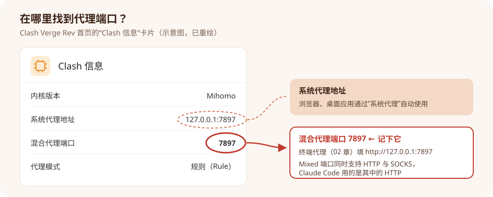
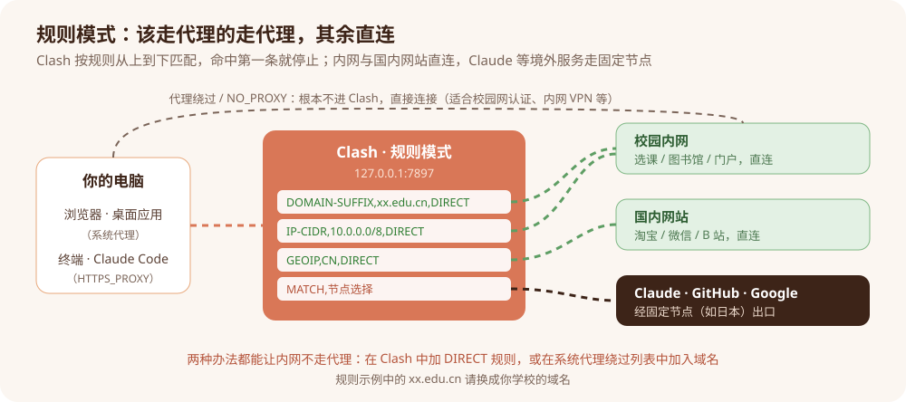
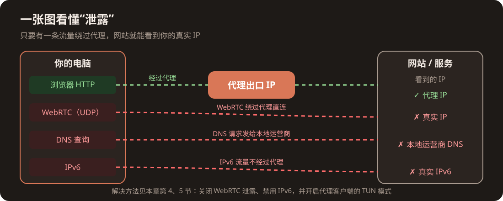
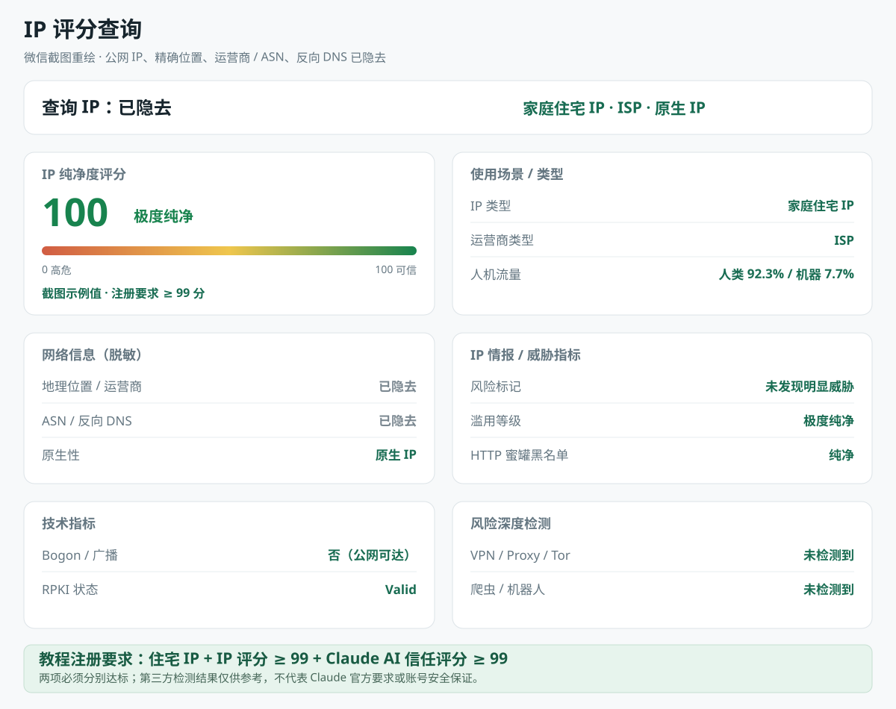
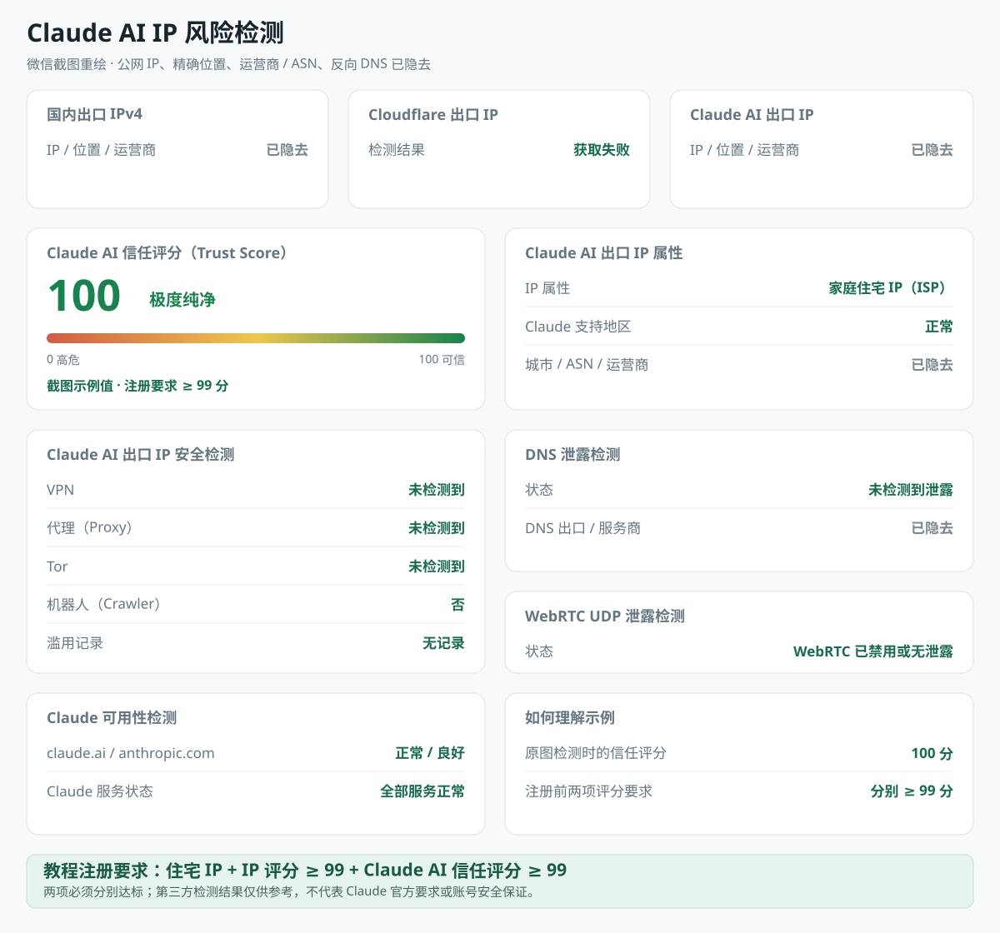

# 01 · 网络准备与 IP 泄露检测

## 注册前的硬性要求

> [!WARNING]
> **注册 Claude 前，必须使用住宅 IP，且以下两项评分必须分别达到 99 分以上（≥ 99/100）：IP 评分查询、Claude AI 信任评分。任何一项低于 99 分，都应先排查并更换符合要求的住宅出口，再注册。**
>
> 这是本教程为培养良好网络使用习惯设定的注册标准，并非 Claude 官方公布的门槛，也不保证注册成功或账号不会受限。日常使用时可以适当放宽评分要求，但仍应保持出口稳定，检查 WebRTC、DNS、IPv6 泄露，避免频繁切换节点。

## 1. 代理选择

| 项目 | 建议 |
| :-- | :-- |
| 选择标准 | 不以价格判断质量；注册前核实住宅属性、出口稳定性和两项评分 |
| 注册时的 IP 类型 | **必须使用住宅 IP**，不能用普通机房节点替代 |
| 注册时的评分 | **IP 评分、Claude AI 信任评分均须 ≥ 99/100**，两项分别检查 |
| 日常使用 | 评分要求可适当放宽，以稳定、少异常验证、无泄露为原则 |
| 节点 | 选择稳定、低延迟的节点并固定使用，避免频繁切换 |
| 客户端模式 | 打开 **系统代理**，代理模式选 **规则（Rule）** 即可；不要用“全局” |



> [!TIP]
> 请记录代理客户端的 **混合代理（Mixed）端口**：Clash Verge Rev / Mihomo 默认 `7897`（旧版 Clash for Windows 为 `7890`），v2rayN 默认 `10808/10809`。第 02 章会用到。

### 规则模式是怎么分流的



规则模式下，Clash 按订阅自带的规则逐条匹配：国内网站、局域网地址直连，Claude、GitHub 等境外服务走你固定的节点。这样国内网站不绕路，Claude 的出口 IP 又保持稳定。

### 让某些网站不走代理（如校园内网）

校园网的选课系统、图书馆数据库、统一认证门户等，通常只允许校内 IP 访问，走了代理就会打不开。有两种办法，**推荐两者都做**：

**办法一：在 Clash 中添加直连规则**（影响所有经过 Clash 的流量，包括终端）

Clash Verge Rev：**订阅** → 右键当前订阅 → **编辑规则**，在“前置规则”中添加；或点 **编辑文件**（Merge / 扩展配置）写入：

```yaml
prepend-rules:                                   # 前置规则，优先于订阅自带规则
  - DOMAIN-SUFFIX,xxx.edu.cn,DIRECT              # 把 xxx.edu.cn 换成你学校的域名
  - DOMAIN-SUFFIX,cnki.net,DIRECT                # 其他需要校内 IP 的站点，如知网
  - IP-CIDR,10.0.0.0/8,DIRECT,no-resolve         # 校园内网常见网段
  - IP-CIDR,172.16.0.0/12,DIRECT,no-resolve
```

保存后在 **连接** 页面打开对应网站，确认规则一栏显示 `DIRECT`。

**办法二：加入系统代理绕过列表**（流量完全不进 Clash，适合校园网登录页、校内 VPN 客户端）

- Clash Verge Rev：**设置 → 系统代理 → 代理绕过**，在已有内容末尾追加 `;*.xxx.edu.cn`（Windows 用分号分隔）。
- 终端：在 `NO_PROXY` 中追加域名，例如 `localhost,127.0.0.1,::1,.xxx.edu.cn`，设置方法见 [02 章](02-terminal-proxy.md#不走代理的地址no_proxy)。

> [!NOTE]
> 改完后需要关闭再重新打开浏览器标签页（已建立的连接不会立即切换）。修改任何代理配置前，记得先按 [04 章](04-stop-claude.md) 终止 Claude。

---

## 2. 泄露的含义



系统代理通常只接管部分流量。**WebRTC（UDP）、DNS 与 IPv6** 是最常见的绕过路径，会使网站获取到本机真实 IP。

---

## 3. 检测网站

| 网站 | 检测内容 | 正常结果 |
| :-- | :-- | :-- |
| **[browserleaks.com/webrtc](https://browserleaks.com/webrtc)** | **WebRTC 专项检测** | 公网 IP 仅显示代理 IP，或显示 `n/a` |
| [browserleaks.com/ip](https://browserleaks.com/ip) | 浏览器出口 IP | 为代理 IP |
| [ipleak.net](https://ipleak.net) | IP、DNS、WebRTC 综合检测 | 未出现本地运营商 |
| [dnsleaktest.com](https://www.dnsleaktest.com) | DNS 泄露（选择 Extended test） | 未出现本地运营商 DNS |
| [test-ipv6.com](https://test-ipv6.com) | IPv6 连通性 | 无 IPv6，或 IPv6 同样经由代理 |
| [ip.net.coffee](https://ip.net.coffee/) · IP 评分查询 | IP 类型与纯净度评分 | **住宅 IP，评分 ≥ 99/100**（注册前） |
| [ip.net.coffee](https://ip.net.coffee/) · Claude AI IP 风险检测 | Claude 出口属性与信任评分 | **住宅出口，信任评分 ≥ 99/100**（注册前） |

**终端出口 IP 检测：**

```bash
curl ipinfo.io        # Bash / WSL / macOS
curl.exe ipinfo.io    # PowerShell（需带 .exe）
```

### 注册前的合格结果示例（已脱敏重绘）

以下两张图根据提供的微信截图重绘，均为 **100 分**。已移除公网 IP、精确位置、运营商 / ASN、反向 DNS 等网络标识，不包含原始截图。图中数据仅代表截图当时的检测结果。





**两项要分别检查，不能只看其中一个高分。** 注册前确认「IP 评分查询」与「Claude AI 信任评分」均 ≥ 99 分，并确认 Claude 实际出口为住宅 IP；不要只根据节点名称或销售描述判断。

**日常使用可以适当放宽评分要求**，无需为了追求满分频繁更换出口。出现 DNS、WebRTC 或 IPv6 泄露提示时，应排查实际出口和解析路径，处理后复测，不能直接忽略。

---

## 4. 禁用 WebRTC 泄露

<details open markdown>
<summary><b>Firefox</b></summary>

地址栏输入 `about:config`，搜索 `media.peerconnection.enabled`，设置为 **false**。

</details>

<details markdown>
<summary><b>Chrome / Edge</b></summary>

安装 **[WebRTC Leak Prevent](https://chromewebstore.google.com/search/WebRTC%20Leak%20Prevent)**，或在 **uBlock Origin** 设置中勾选“防止 WebRTC 泄露本地 IP”。
完成后在 [browserleaks.com/webrtc](https://browserleaks.com/webrtc) 复测。

</details>

<details markdown>
<summary><b>Safari / iPad</b></summary>

Safari 默认不暴露本地 IP。确保代理 App 处于**全局 / VPN 模式**，再通过 Safari 打开检测网站确认。

</details>

---

## 5. 禁用 IPv6

| 系统 | 跳转 |
| :-- | :-- |
| Windows | [Windows](#windows) |
| Linux / WSL | [Linux / WSL](#linux--wsl) |
| macOS | [macOS](#macos) |

### Windows

以**管理员身份**运行 PowerShell，两步均需执行：

```powershell
# 1. 在所有网卡上取消 IPv6 绑定
Get-NetAdapterBinding -ComponentID ms_tcpip6 | Disable-NetAdapterBinding -ComponentID ms_tcpip6

# 2. 通过注册表全局禁用（0xFF），重启后生效
New-ItemProperty -Path 'HKLM:\SYSTEM\CurrentControlSet\Services\Tcpip6\Parameters' `
  -Name DisabledComponents -PropertyType DWord -Value 0xFF -Force
```

也可使用仓库脚本：`.\scripts\ipv6.ps1 off`（恢复：`.\scripts\ipv6.ps1 on`）

<details markdown>
<summary>手动恢复 IPv6</summary>

```powershell
Get-NetAdapterBinding -ComponentID ms_tcpip6 | Enable-NetAdapterBinding -ComponentID ms_tcpip6
Remove-ItemProperty -Path 'HKLM:\SYSTEM\CurrentControlSet\Services\Tcpip6\Parameters' -Name DisabledComponents
```

</details>

> [!NOTE]
> 禁用后 `ping ::1` 仍可成功属正常现象（本机回环）。以 [test-ipv6.com](https://test-ipv6.com) 显示无 IPv6 为准。

### Linux / WSL

```bash
sudo tee /etc/sysctl.d/99-disable-ipv6.conf >/dev/null <<'EOF'
net.ipv6.conf.all.disable_ipv6 = 1
net.ipv6.conf.default.disable_ipv6 = 1
net.ipv6.conf.lo.disable_ipv6 = 1
EOF
sudo sysctl --system
```

WSL 也可在 Windows 的 `%USERPROFILE%\.wslconfig` 中添加：

```ini
[wsl2]
kernelCommandLine = ipv6.disable=1
```

随后执行 `wsl --shutdown` 并重新打开。

### macOS

```bash
networksetup -listallnetworkservices          # 查看网络服务名称
networksetup -setv6off "Wi-Fi"
networksetup -setv6off "Ethernet"             # 如有有线网卡，一并关闭
# 恢复：networksetup -setv6automatic "Wi-Fi"
```

---

## 6. 代理上网的好习惯

现在代理服务良莠不齐，很多节点被成百上千人共用，还被拿去跑爬虫、刷量。这样的 IP **信誉**很差，结果就是：用 Google 搜索要选红绿灯，打开很多网站都要先“检查浏览器”，频繁的验证严重影响日常使用。



### 怎样判断节点好不好

| 信号 | 说明 |
| :-- | :-- |
| 经常弹人机验证 | 最直观的信号：IP 信誉差，不是你的浏览器有问题 |
| 被网站提示“异常流量” | 这个 IP 上有大量自动化请求，已被列入风险名单 |
| IP 检测站的风险项偏多 | 用 [01 章 · 检测网站](#3-检测网站) 查看是否有滥用记录、黑名单、机器流量比例高 |
| 同一节点时快时慢、频繁断线 | 用户太多、超售严重 |

> [!TIP]
> **注册阶段必须遵守本教程的住宅 IP + 两项评分均 ≥ 99 分要求。** 日常使用可适当放宽评分要求；检测站算法不同，仍要结合连接稳定性、异常验证频率和泄露检测判断质量。

### 好习惯清单

<div class="cd-cards" markdown>

<div markdown>

**选正规服务**

不用来路不明的免费节点。免费节点几乎都是被滥用过的烂 IP，还可能记录你的流量。

</div>

<div markdown>

**固定一个好节点**

找到一个稳定、少验证的节点后固定使用，不要频繁切换，忽东忽西的 IP 本身就容易触发验证。

</div>

<div markdown>

**切换前先收尾**

需要切换节点或调整代理时，先关闭正在使用的应用和登录中的服务，Claude 用 [一键终止](04-stop-claude.md) 脚本，再切换。

</div>

<div markdown>

**国内网站直连**

用规则模式，国内网站和学校网站直连（见[第 1 节](#让某些网站不走代理如校园内网)），既不绕路，也不会因为境外 IP 被国内网站风控。

</div>

<div markdown>

**堵住泄露**

按第 4、5 节关闭 WebRTC、处理 IPv6，避免同一个账号同时出现两个不同的 IP。

</div>

<div markdown>

**不要共享账号**

账号不借给别人、不在多台陌生设备上同时登录，这是被各类网站风控最常见的原因。

</div>

</div>

---

## 检查清单

- [ ] 代理客户端已开启系统代理、选择规则模式，并记下混合端口（如 `7897`）
- [ ] 校园内网等站点已加入直连规则 / 代理绕过（如有需要）
- [ ] **注册前：Claude 实际出口已确认为住宅 IP**
- [ ] **注册前：[IP 评分查询](https://ip.net.coffee/) ≥ 99/100**
- [ ] **注册前：[Claude AI 信任评分](https://ip.net.coffee/) ≥ 99/100**
- [ ] Claude AI 出口保持稳定，支持地区正常；日常使用可适当放宽评分要求
- [ ] [browserleaks.com/webrtc](https://browserleaks.com/webrtc) 仅显示代理 IP
- [ ] [test-ipv6.com](https://test-ipv6.com) 显示无 IPv6

**[下一章：终端代理配置 →](02-terminal-proxy.md)**
