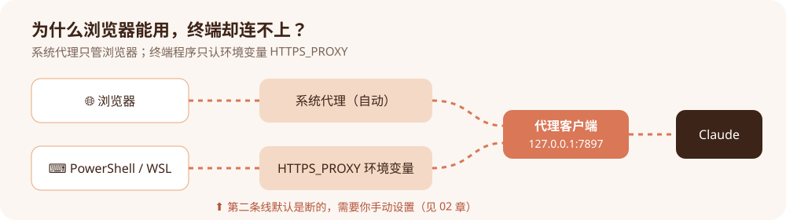
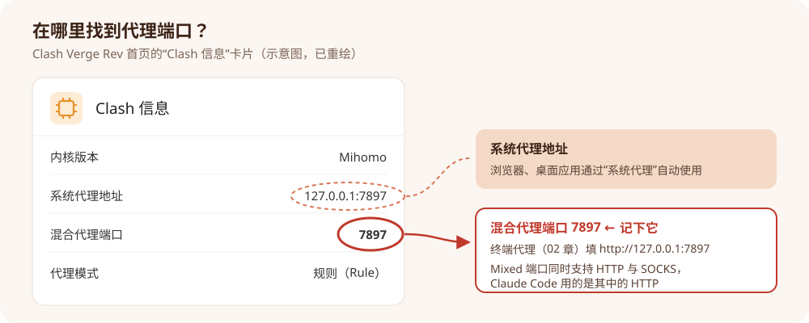

# 02 · 终端永久代理配置



浏览器走的是系统代理，而终端里的程序（包括 Claude Code）只读取 `HTTP_PROXY` / `HTTPS_PROXY` 环境变量。因此即使浏览器能正常访问，终端也需要单独配置。

本章为每种终端给出 **生效范围 → 配置步骤 → 验证 → 撤销** 四个部分，按自己使用的终端阅读即可。

## 开始之前：确认代理端口

打开代理客户端的设置，找到 **HTTP 端口** 或 **Mixed（混合）端口**，下文统一以 Clash Verge Rev 的默认端口 `7897` 为例，请替换为你自己的端口。



| 常见客户端 | 默认端口 |
| :-- | :-- |
| Clash Verge Rev / Mihomo Party | `7897`（混合端口，见首页“Clash 信息”卡片） |
| Clash for Windows（旧版） | `7890`（Mixed） |
| v2rayN | `10809`（HTTP），`10808` 为 SOCKS |
| Shadowrocket / Surge（macOS） | 以客户端设置页显示为准 |

> [!IMPORTANT]
> Claude Code **不支持 SOCKS5**，必须填写 HTTP 或 Mixed 端口。

## 选择你的终端

| 终端 | 跳转 | 说明 |
| :-- | :-- | :-- |
| PowerShell / CMD / Git Bash（Windows） | [Windows 终端](#windows-终端) | 三者共用 Windows 用户环境变量，配置一次即可 |
| WSL | [WSL](#wsl) | 独立的 Linux 环境，**不继承** Windows 的环境变量，需要单独配置 |
| macOS / Linux | [macOS / Linux](#macos--linux) | 写入 shell 配置文件 |
| 仅 Claude Code | [Claude Code 专用配置](#claude-code-专用配置) | 与终端无关，作为兜底方案 |

---

## Windows 终端

**生效范围：** 写入 Windows **用户环境变量**后，之后新打开的 PowerShell、CMD、Git Bash、Windows Terminal、VS Code 都会自动继承，无需分别配置。已经打开的窗口不会更新，WSL 也不受影响。

### 配置步骤

**方式一：脚本**（在仓库根目录的 PowerShell 中执行）

```powershell
.\scripts\proxy.ps1 on 7897
```

**方式二：手动**（PowerShell 中逐行执行，无需管理员权限）

```powershell
$p = 'http://127.0.0.1:7897'
[Environment]::SetEnvironmentVariable('HTTP_PROXY',  $p, 'User')
[Environment]::SetEnvironmentVariable('HTTPS_PROXY', $p, 'User')
[Environment]::SetEnvironmentVariable('ALL_PROXY',   $p, 'User')
[Environment]::SetEnvironmentVariable('NO_PROXY', 'localhost,127.0.0.1,::1', 'User')
```

如果习惯用 CMD，以下命令效果相同：

```bat
setx HTTP_PROXY  http://127.0.0.1:7897
setx HTTPS_PROXY http://127.0.0.1:7897
setx ALL_PROXY   http://127.0.0.1:7897
setx NO_PROXY    localhost,127.0.0.1,::1
```

**方式三：图形界面**

`Win + R` 输入 `rundll32 sysdm.cpl,EditEnvironmentVariables` → 在“用户变量”中新建 `HTTP_PROXY`、`HTTPS_PROXY`，值均为 `http://127.0.0.1:7897`。

**最后一步（必做）：** 关闭**所有** PowerShell、CMD、Windows Terminal 与 VS Code 窗口（VS Code 需完全退出，而不是只关闭终端面板），再重新打开。

### 验证

PowerShell：

```powershell
$env:HTTPS_PROXY          # 应输出 http://127.0.0.1:7897
curl.exe ipinfo.io        # 应显示代理节点的 IP（注意要带 .exe）
```

CMD 中使用 `echo %HTTPS_PROXY%` 与 `curl ipinfo.io`；Git Bash 中使用 `echo $HTTPS_PROXY` 与 `curl ipinfo.io`。

也可运行仓库中的 `.\scripts\check.ps1` 一次性检查。

### 撤销

```powershell
.\scripts\proxy.ps1 off
```

或手动执行：

```powershell
'HTTP_PROXY','HTTPS_PROXY','ALL_PROXY','NO_PROXY' | ForEach-Object {
  [Environment]::SetEnvironmentVariable($_, $null, 'User')
}
```

<details markdown>
<summary>附：让 Git 与 npm 也走代理</summary>

Git 与 npm 通常会读取上面的环境变量。如果仍然不生效，可单独配置：

```powershell
git config --global http.proxy  http://127.0.0.1:7897
git config --global https.proxy http://127.0.0.1:7897
npm config set proxy       http://127.0.0.1:7897
npm config set https-proxy http://127.0.0.1:7897
```

撤销：`git config --global --unset http.proxy`、`git config --global --unset https.proxy`、`npm config delete proxy`、`npm config delete https-proxy`。

</details>

---

## WSL

**生效范围：** 写入 WSL 中的 `~/.bashrc`（以及 `~/.zshrc`，如果使用 zsh）后，之后每次打开 WSL 终端都会自动生效。

WSL 有两种网络模式，代理地址不同：

| 网络模式 | WSL 中的 `127.0.0.1` | 代理地址 |
| :-- | :-- | :-- |
| NAT（默认，所有版本都支持） | 指向 WSL 自身，**不是** Windows | Windows 主机 IP，且每次重启可能变化 |
| 镜像 mirrored（仅部分 Windows 11 支持） | 与 Windows 共享 | `127.0.0.1` |

下面的**通用方法**会在每次打开终端时自动判断：`127.0.0.1` 可用就用它，否则自动改用 Windows 主机 IP。**两种模式都适用，无需关心自己的系统是否支持镜像网络。**

### 第 1 步：代理客户端允许局域网连接

WSL 在 NAT 模式下属于“另一台机器”，需要代理客户端接受来自局域网的连接：

| 客户端 | 设置位置 |
| :-- | :-- |
| Clash Verge / Mihomo | 设置 → **局域网连接（Allow LAN）** 打开 |
| Clash for Windows | General → **Allow LAN** 打开 |
| v2rayN | 设置 → 参数设置 → **允许来自局域网的连接** 打开 |

### 第 2 步：写入配置

**方式一：脚本**（在 WSL 中进入仓库目录执行）

```bash
bash scripts/proxy.sh on 7897
source ~/.bashrc
```

**方式二：手动**，复制以下整段到 WSL 终端执行（会追加到 `~/.bashrc`；使用 zsh 的话把两处 `~/.bashrc` 改为 `~/.zshrc`）：

```bash
cat >> ~/.bashrc <<'EOF'

# >>> claude-diy proxy >>>
PROXY_PORT=7897
if timeout 1 bash -c "</dev/tcp/127.0.0.1/$PROXY_PORT" 2>/dev/null; then
  PROXY_HOST=127.0.0.1                                              # 镜像网络
else
  PROXY_HOST=$(ip route show default | awk '{print $3; exit}')      # NAT：Windows 主机 IP
fi
export HTTP_PROXY="http://$PROXY_HOST:$PROXY_PORT"
export HTTPS_PROXY="$HTTP_PROXY" ALL_PROXY="$HTTP_PROXY"
export http_proxy="$HTTP_PROXY" https_proxy="$HTTP_PROXY" all_proxy="$HTTP_PROXY"
export NO_PROXY=localhost,127.0.0.1,::1 no_proxy=localhost,127.0.0.1,::1
# <<< claude-diy proxy <<<
EOF
source ~/.bashrc
```

### 第 3 步：验证

```bash
echo $HTTPS_PROXY       # NAT 模式下形如 http://172.x.x.1:7897
curl ipinfo.io          # 应显示代理节点的 IP
```

### 连不上时：放行 Windows 防火墙

如果 `curl` 超时，通常是 Windows 防火墙拦截了来自 WSL 的连接。以**管理员身份**打开 PowerShell，执行一次即可（只放行 WSL 所在的内网网段）：

```powershell
New-NetFirewallRule -DisplayName "WSL to Proxy" -Direction Inbound -Action Allow `
  -Protocol TCP -LocalPort 7897 -RemoteAddress 172.16.0.0/12
```

撤销：`Remove-NetFirewallRule -DisplayName "WSL to Proxy"`

仍然不行时，按顺序检查：

1. 代理客户端是否正在运行，“允许局域网连接”是否已打开；
2. 端口是否填写正确（HTTP / Mixed 端口，而非 SOCKS）；
3. 在 WSL 中执行 `ip route show default`，确认能输出一个 IP 地址；
4. 部分客户端在打开“允许局域网”后需要重启才生效。

### 撤销

```bash
bash scripts/proxy.sh off
```

或手动删除 `~/.bashrc` 中 `# >>> claude-diy proxy >>>` 与 `# <<< claude-diy proxy <<<` 之间的内容，然后重开终端。

<details markdown>
<summary>附：开启镜像网络（可选，仅部分 Windows 11 支持）</summary>

在 Windows 中编辑 `%USERPROFILE%\.wslconfig`（不存在则新建）：

```ini
[wsl2]
networkingMode=mirrored
```

在 PowerShell 中执行 `wsl --shutdown`，再重新打开 WSL。如果系统不支持，WSL 会给出提示并继续使用 NAT 模式。上面的通用方法在两种模式下都能工作，开不开镜像网络都不影响。

</details>

---

## macOS / Linux

**生效范围：** 写入 shell 配置文件后，之后每次打开的终端都会生效。macOS 默认使用 zsh（`~/.zshrc`），大多数 Linux 默认使用 bash（`~/.bashrc`）。不确定时执行 `echo $SHELL` 查看。

### 配置步骤

**方式一：脚本**

```bash
bash scripts/proxy.sh on 7897
source ~/.zshrc        # bash 用户改为 source ~/.bashrc
```

**方式二：手动**（zsh 用户将两处 `~/.bashrc` 改为 `~/.zshrc`）

```bash
cat >> ~/.bashrc <<'EOF'

# >>> claude-diy proxy >>>
export HTTP_PROXY=http://127.0.0.1:7897
export HTTPS_PROXY="$HTTP_PROXY" ALL_PROXY="$HTTP_PROXY"
export http_proxy="$HTTP_PROXY" https_proxy="$HTTP_PROXY" all_proxy="$HTTP_PROXY"
export NO_PROXY=localhost,127.0.0.1,::1 no_proxy=localhost,127.0.0.1,::1
# <<< claude-diy proxy <<<
EOF
source ~/.bashrc
```

### 验证

```bash
echo $HTTPS_PROXY
curl ipinfo.io
```

### 撤销

```bash
bash scripts/proxy.sh off
```

或手动删除配置文件中两行标记之间的内容，然后重开终端。

---

## Claude Code 专用配置

**生效范围：** 只影响 Claude Code，与从哪个终端启动无关。当环境变量因为某种原因没有生效时，可以用它兜底。

编辑配置文件（不存在则新建）：

| 系统 | 路径 |
| :-- | :-- |
| Windows | `C:\Users\<用户名>\.claude\settings.json` |
| macOS / Linux / WSL | `~/.claude/settings.json` |

```json
{
  "env": {
    "HTTP_PROXY": "http://127.0.0.1:7897",
    "HTTPS_PROXY": "http://127.0.0.1:7897"
  }
}
```

如果文件中已有其他配置，只需把 `env` 一项合并进去。WSL 在 NAT 模式下这里不能写 `127.0.0.1`，请优先使用上面的 [WSL 通用方法](#wsl)。

**验证：** 重新启动 `claude`，能正常对话即配置成功；也可以运行 `claude doctor` 查看。

---

## 不走代理的地址（NO_PROXY）

`NO_PROXY` 中列出的地址，终端程序（curl、git、npm、Claude Code 等）会直接连接，不经过代理。脚本默认写入 `localhost,127.0.0.1,::1`。如果需要在终端里访问校园内网，把学校域名追加进去，以英文逗号分隔，域名前加 `.` 表示包含所有子域名：

```powershell
# Windows（PowerShell）
[Environment]::SetEnvironmentVariable('NO_PROXY', 'localhost,127.0.0.1,::1,.xxx.edu.cn', 'User')
```

```bash
# WSL / macOS / Linux：修改 ~/.bashrc 或 ~/.zshrc 中 claude-diy 标记内的这一行
export NO_PROXY=localhost,127.0.0.1,::1,.xxx.edu.cn no_proxy=localhost,127.0.0.1,::1,.xxx.edu.cn
```

改完同样需要重开终端。浏览器的绕过设置与 Clash 直连规则见 [01 章 · 让某些网站不走代理](01-network.md#让某些网站不走代理如校园内网)。

> [!NOTE]
> 即使不改 `NO_PROXY`，只要 Clash 中已添加了对应的 `DIRECT` 规则，终端访问内网也会由 Clash 直连转发。`NO_PROXY` 适合连 Clash 都不该经过的情况，例如校园网认证。

---

## 常见问题

| 现象 | 原因与解决 |
| :-- | :-- |
| `echo $HTTPS_PROXY` 为空 | 没有重开终端；VS Code 需要完全退出后再打开 |
| `curl ipinfo.io` 显示本地 IP | 环境变量未生效，或端口填写错误 |
| PowerShell 中 `curl ipinfo.io` 报错 | PowerShell 的 `curl` 是别名，请使用 `curl.exe` |
| WSL 中 `curl` 超时 | 未打开“允许局域网连接”，或被 Windows 防火墙拦截，见 [放行防火墙](#连不上时放行-windows-防火墙) |
| 浏览器正常，`claude` 无响应 | 终端代理未配置，或填写了 SOCKS 端口 |

**[下一章：安装与使用 →](03-install-and-usage.md)**
