# 03 · 安装与使用

## 1. 安装

推荐按以下顺序选择，**优先使用官方桌面应用**：

| 顺序 | 方式 | 适合 | 跳转 |
| :--: | :-- | :-- | :-- |
| 1 | **Claude 桌面应用**（Windows / macOS） | 大多数用户，图形界面，开箱即用 | [桌面应用](#方式一claude-桌面应用推荐) |
| 2 | **VS Code 插件** | 主要在 VS Code 中写代码 | [VS Code 插件](#方式二vs-code-插件) |
| 3 | **命令行版**（Windows / macOS / Linux / WSL） | 习惯终端、需要在 WSL 或服务器中使用 | [命令行版](#方式三命令行版) |

三种方式使用同一个账号，可以同时安装、按需切换。

### 方式一：Claude 桌面应用（推荐）

官方桌面应用内置了 Claude Code（即 **Code** 标签页），**无需另外安装命令行工具**。

**下载：** 打开官方下载页 [claude.ai/download](https://claude.ai/download)，或直接下载：

| 系统 | 下载链接 |
| :-- | :-- |
| Windows（x64，大多数电脑） | [Claude Setup for Windows x64](https://claude.ai/api/desktop/win32/x64/setup/latest/redirect) |
| Windows（ARM64） | [Claude Setup for Windows ARM64](https://claude.ai/api/desktop/win32/arm64/setup/latest/redirect) |
| macOS（Intel 与 Apple 芯片通用） | [Claude for macOS](https://claude.ai/api/desktop/darwin/universal/dmg/latest/redirect) |

**使用：**

1. 安装并打开 Claude，登录账号；
2. 点击顶部的 **Code** 标签页；
3. 点击 **+ New**（Windows 快捷键 `Ctrl + N`，macOS 为 `Cmd + N`）；
4. 在输入框下方选择项目文件夹、权限模式和模型；
5. 输入任务，按 `Enter` 发送。

> [!NOTE]
> 桌面应用通过系统网络联网，请在代理客户端中打开 **系统代理** 并选择 **规则模式**（见 [01 章](01-network.md#1-代理选择)）。如果 Code 会话仍然连不上，按 [02 章 · Claude Code 专用配置](02-terminal-proxy.md#claude-code-专用配置) 补充代理设置。
>
> 部分功能（如并行会话隔离）需要 Git：Windows 用户可安装 [Git for Windows](https://git-scm.com/downloads/win)；macOS 一般自带，可在终端执行 `git --version` 确认。

### 方式二：VS Code 插件

1. 在 VS Code 扩展商店搜索 **Claude Code**，安装 Anthropic 官方发布的插件；
2. 点击侧边栏的 Claude 图标，按提示登录；
3. 打开项目文件夹即可开始对话。

插件读取的是 Windows 用户环境变量，因此按 [02 章](02-terminal-proxy.md#windows-终端) 配置代理后，需**完全退出 VS Code 再重新打开**。

### 方式三：命令行版

| 系统 | 跳转 |
| :-- | :-- |
| Windows（PowerShell） | [Windows](#windows) |
| macOS / Linux / WSL | [macOS / Linux / WSL](#macos--linux--wsl) |

#### Windows

```powershell
irm https://claude.ai/install.ps1 | iex
```

备选方式：`winget install Anthropic.ClaudeCode`

> [!NOTE]
> 原生 Windows 命令行版需预先安装 [Git for Windows](https://git-scm.com/downloads/win)，Claude Code 通过其附带的 Bash 执行命令。

#### macOS / Linux / WSL

```bash
curl -fsSL https://claude.ai/install.sh | bash
```

备选方式（macOS）：`brew install --cask claude-code`

**验证安装：**

```bash
claude --version
claude doctor      # 环境自检，会列出存在的问题
```

---

## 2. 登录

**桌面应用 / VS Code 插件：** 按界面提示登录即可。

**命令行版：**

```bash
cd <项目目录>
claude
```

首次启动会打开浏览器进行登录。**Pro / Max 订阅**用户选择 Claude 账号登录；**API 按量计费**用户选择 Console 账号。

---

## 3. 登录后：让 Claude 帮你把网络配完

登录成功后，你的第一个任务可以交给 Claude 自己完成：让它把 Claude Code 的代理配置写好，并把代理软件调整为 **TUN 模式 + 防 DNS 泄露 + 国内与学校网站直连**。这样以后无论从哪个终端、哪个应用使用 Claude，网络都是一致的。

<div class="cd-steps" markdown>

1. **确认你的代理端口**：在 Clash Verge Rev 的“设置”页找到 **混合代理端口**（默认 `7897`），方法见 [01 章](01-network.md#1-代理选择)。

2. **复制下面整段提示词**，把 `7897` 换成你的端口、把 `hkust-gz.edu.cn` 换成你学校的域名（没有可以删掉这一行），然后发给 Claude：

    ```text
    请控制我的电脑，根据我目前使用的代理软件和端口帮我完成以下配置（打开tun模式，永久防止dns泄露）。

    1. 编辑 ~/.claude/settings.json（Windows 为 C:\Users\<用户名>\.claude\settings.json，
       不存在就新建）。保留文件中已有的配置，只合并加入：
       {
         "env": {
           "HTTP_PROXY": "http://127.0.0.1:<我的端口>",
           "HTTPS_PROXY": "http://127.0.0.1:<我的端口>"
         }
       }

    2. 找到代理的全局扩展配置文件，在其中加入以下内容，
       已有同名字段的话合并而不是覆盖：
       - 开启 TUN：tun.enable: true，stack: mixed，auto-route: true，
         auto-detect-interface: true，strict-route: true，dns-hijack: [any:53]
       - 防 DNS 泄露：dns.enable: true，enhanced-mode: fake-ip，ipv6: false，
         respect-rules: true；nameserver 使用 https://1.1.1.1/dns-query 和
         https://8.8.8.8/dns-query；proxy-server-nameserver 与 default-nameserver
         使用 223.5.5.5；nameserver-policy 中让 geosite:cn 使用
         https://223.5.5.5/dns-query
       - 直连规则：用 prepend-rules 在最前面加入
         DOMAIN-SUFFIX,hkust-gz.edu.cn,DIRECT
         DOMAIN-SUFFIX,edu.cn,DIRECT
         GEOSITE,cn,DIRECT
         GEOIP,CN,DIRECT
         并把 +.hkust-gz.edu.cn 加入 dns.fake-ip-filter
    ```

3. **Claude 改完后，按顺序收尾：**

    1. 运行 [`stop-all-claude.bat`](04-stop-claude.md) 终止所有 Claude 进程（修改代理前必做，原因见 [04 章](04-stop-claude.md#为什么要先终止所有进程)）；
    2. 在 Clash Verge Rev 中：**设置 → 虚拟网卡模式（TUN）** 打开。首次开启需要先点旁边的按钮安装 **服务模式**；
    3. 在 **订阅** 页面重新应用当前配置，或重启 Clash Verge Rev；
    4. 按 [01 章 · 检测网站](01-network.md#3-检测网站) 检查：出口 IP 是你固定的节点、DNS 检测没有出现本地运营商、学校网站可以正常打开；
    5. 重新打开 Claude，能正常对话即完成。

</div>

> [!NOTE]
> 这一步需要 Claude 修改你电脑上的配置文件，它会逐项请求你确认，看清楚再批准。如果你用的不是 Clash Verge Rev（例如 v2rayN），把提示词第 2 步里的软件名换成你用的软件，Claude 会按对应的格式修改。

> [!TIP]
> 想让更多学校网站或内网直连，以后随时可以对 Claude 说：“把 xxx.edu.cn 加入 Clash 的直连规则”。

---

## 4. 基本操作



### 快捷键

| 按键 | 作用 |
| :-- | :-- |
| `Esc` | 中断 Claude 当前操作 |
| `Esc` `Esc` | 回退到之前的某条消息 |
| `Shift + Tab` | 切换模式：普通 → 自动接受编辑 → **Plan 模式**（仅规划，不修改） |
| `@文件名` | 将指定文件加入上下文 |
| `!命令` | 直接执行 shell 命令 |
| 连按两次 `Ctrl + C` | 退出 |

### 斜杠命令

| 命令 | 作用 |
| :-- | :-- |
| `/init` | 扫描项目并生成 `CLAUDE.md`（新项目建议首先执行） |
| `/clear` | 清空上下文，开始新话题 |
| `/compact` | 压缩上下文，保留要点 |
| `/model` | 切换模型 |
| `/resume` | 恢复历史会话 |
| `/permissions` | 管理免确认的命令 |
| `/usage` | 查看用量 |
| `/help` | 查看全部命令 |

### 命令行参数

```bash
claude "解释这个项目"          # 携带初始问题启动
claude -c                      # 继续最近一次会话
claude -r                      # 选择历史会话恢复
claude -p "总结 README"        # 非交互模式，输出结果后退出
```

---

## 5. 任务描述建议

```text
1. 先理解，不修改：  阅读这个项目，说明入口、结构和测试命令，暂不修改文件。
2. 明确验收标准：    为登录接口补充单元测试，覆盖密码错误和 token 过期，完成后运行 npm test。
3. 要求自查：        审查刚才的改动，列出尚未覆盖的边界情况。
```

> [!TIP]
> 对于较大的改动，建议先按 `Shift+Tab` 进入 **Plan 模式**，确认方案后再执行。

---

## 6. CLAUDE.md

放置在项目根目录，每次启动时自动读取，用于记录项目约定：

```markdown
# 项目约定
- 包管理使用 pnpm，测试命令为 pnpm test
- 使用中文回复
- 修改代码后必须运行测试
- 不得修改 legacy/ 目录
```

全局偏好可写入 `~/.claude/CLAUDE.md`，对所有项目生效。

---

## 7. 进阶功能

| 功能 | 说明 | 文档 |
| :-- | :-- | :-- |
| MCP | 接入浏览器、数据库、GitHub 等外部工具 | [MCP](https://code.claude.com/docs/en/mcp) |
| Hooks | 在特定事件触发时自动执行命令 | [Hooks](https://code.claude.com/docs/en/hooks) |
| Subagents | 将子任务分派给独立的子代理 | [Subagents](https://code.claude.com/docs/en/sub-agents) |
| Skills | 封装可复用的工作流程 | [Skills](https://code.claude.com/docs/en/skills) |
| IDE 集成 | 在 VS Code / JetBrains 中使用 | [IDE](https://code.claude.com/docs/en/vs-code) |

**[下一章：终止所有 Claude 进程 →](04-stop-claude.md)**
