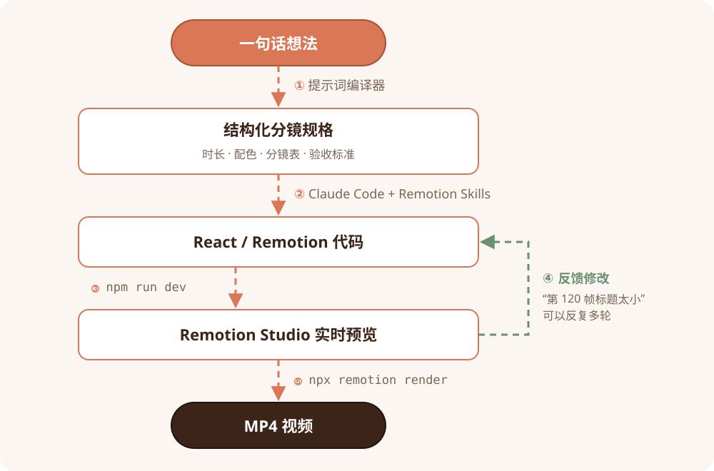

# 06 · 实战：用 Claude + Remotion 做动画

这一章用一个完整的例子，演示如何只靠“说话”做出一段动画视频：先用 **提示词编译器（Prompt Compiler）** 把一句模糊的想法扩写成详细的分镜规格，再交给 Claude Code 在 **Remotion** 项目里写代码、预览、渲染。

## 1. 先理解三件事

| 角色 | 是什么 | 在流程中负责 |
| :-- | :-- | :-- |
| **Remotion** | 用 React 写视频的开源框架。每一帧都是一个 React 组件的渲染结果，最终导出为 MP4 | 把代码变成视频 |
| **Claude Code** | 在项目中读写代码、执行命令的 AI 助手 | 根据规格写 Remotion 代码、修改、调试 |
| **提示词编译器** | 一段“生成提示词的提示词”（prompt of prompts） | 把“做个酷炫的开场动画”这种一句话想法，编译成时长、分镜、配色、动画参数都写清楚的规格说明 |

为什么要多一层“编译”？因为直接对 Claude 说“做个好看的动画”，它只能猜：多长、什么风格、几个场景、文字是什么。猜错了就要来回返工。先把想法编译成一份**结构化的规格**，相当于先出分镜脚本再开拍，一次成功率高得多，后续修改也有据可依。



## 2. 准备工作

- 已按 [03 章](03-install-and-usage.md) 安装好 Claude Code（桌面应用的 Code 标签页或命令行版均可）；
- 安装 [Node.js](https://nodejs.org/) LTS 版本，终端执行 `node -v` 能看到版本号；
- 终端已按 [02 章](02-terminal-proxy.md) 配置代理：`npx` 下载依赖、Remotion 首次渲染时下载浏览器内核，都需要网络。

> [!NOTE]
> **Remotion 的许可证**：个人、3 人及以下的团队、非营利组织以及评估试用可以免费使用（含商用）；4 人及以上的公司需要购买公司授权。详见 [Remotion 许可说明](https://www.remotion.dev/docs/license)。

## 3. 创建 Remotion 项目

以下命令来自 [Remotion 官方的 Claude Code 指引](https://www.remotion.dev/docs/ai/claude-code)：

```bash
# 1. 创建一个空白项目
npx create-video --yes --blank my-video
cd my-video

# 2. 安装 Remotion 官方的 Agent Skills（让 Claude 掌握 Remotion 的最佳实践）
npx remotion skills add

# 3. 启动预览（Remotion Studio）
npm run dev
```

浏览器会打开 Remotion Studio（通常是 `http://localhost:3000`）。保持它运行，**另开一个终端**启动 Claude：

```bash
cd my-video
claude
```

使用桌面应用的话，在 Code 标签页中选择 `my-video` 文件夹即可。

## 4. 第一步：安装提示词编译器

我们把提示词编译器做成一个 Claude Code **skill**，以后在任何视频项目里输入 `/video-prompt-compiler 你的想法` 就能调用。（skill 的原理见 [进阶 · Skills](howto/03-skills/README.md)。）

在 `my-video` 项目中新建文件 `.claude/skills/video-prompt-compiler/SKILL.md`，内容如下：

````markdown
---
name: video-prompt-compiler
description: 把一句话的视频想法编译成可直接交给 Claude Code 执行的 Remotion 分镜规格。用户想做动画、视频、片头，或者输入 /video-prompt-compiler 时使用。
---

你是一名动画导演兼 Remotion 工程师。你的任务不是写代码，而是把用户的想法“编译”成一份完整、无歧义的视频规格说明，供下一步写代码使用。

用户的想法：$ARGUMENTS

## 编译步骤

1. 如果想法缺少关键信息（用途、时长、画幅、文案），先用一次提问补齐，最多 3 个问题；用户说“你决定”则自行给出合理默认值。
2. 按下面的模板输出规格，所有数值必须具体，不允许出现“适当”“酷炫一点”这类模糊词。

## 输出模板

### 基本参数
- 分辨率与画幅：（例如 1920×1080，16:9）
- 帧率：30 fps
- 总时长：X 秒 = Y 帧
- Composition ID：（英文驼峰，例如 BrandIntro）

### 视觉风格
- 背景色、主色、强调色：给出 HEX 色值
- 字体：中文使用 Noto Sans SC（通过 @remotion/google-fonts 加载），英文字体单独指定
- 整体气质：用 3 个形容词描述，并给出 1 个参考（例如“Apple 发布会式极简”）

### 分镜表
| 场景 | 帧范围 | 画面内容 | 动画（入场 / 停留 / 出场） | 文案 |
| --- | --- | --- | --- | --- |
（每个场景一行，帧范围首尾相接、无空隙；动画写明使用 spring 还是 interpolate、起止数值和缓动方式）

### 技术约束
- 所有动画必须由 useCurrentFrame() 驱动，使用 interpolate() 或 spring()；禁止使用 CSS transition / animation
- 场景用 <Sequence> 或 <Series> 组织，每个场景拆成独立组件文件
- 素材只使用代码绘制的图形、SVG 或 public/ 目录下的文件，不引用外部网络图片
- 在 src/Root.tsx 中注册 Composition

### 验收标准
- 列出 3–5 条可在 Remotion Studio 中逐帧检查的标准（例如“第 45 帧标题完全不透明且居中”）

最后一行输出：「规格已就绪，回复“开始制作”即可按此规格编写代码。」
````

保存后，在 Claude 中输入 `/` 应能看到 `video-prompt-compiler`。

> [!TIP]
> 不想建文件也可以：把上面 `---` 之后的正文复制下来，把 `$ARGUMENTS` 换成你的想法，直接发给 Claude（甚至在 claude.ai 网页版里发也行），得到规格后再粘贴给 Claude Code。

## 5. 第二步：编译你的想法

在 Claude 中输入：

```text
/video-prompt-compiler 给 ClaudeDIY 做一个 10 秒的片头：星芒 logo 旋转出现，然后打出“ClaudeDIY · Claude Code 自学指南”，暖橙色调
```

编译器会输出类似这样的规格（节选）：

```text
### 基本参数
- 1920×1080，16:9；30 fps；总时长 10 秒 = 300 帧；Composition ID：ClaudeDiyIntro

### 视觉风格
- 背景 #1A1410，主色 #D97757，强调色 #F4B183，文字 #F5EDE6
- 中文 Noto Sans SC 800 字重；英文 JetBrains Mono

### 分镜表
| 场景 | 帧范围 | 画面内容 | 动画 | 文案 |
| 1 | 0–89 | 12 条射线组成的星芒 | spring 缩放 0→1（damping 12），同时旋转 0→180° | 无 |
| 2 | 90–209 | 星芒左移，右侧出现标题 | 星芒 x 由 0 interpolate 到 -420；标题逐字出现，每字间隔 3 帧 | ClaudeDIY |
| 3 | 210–299 | 副标题与底部光晕 | 副标题 opacity 0→1、y 20→0（20 帧）；最后 15 帧整体淡出 | Claude Code 自学指南 |
```

检查一遍规格：时长、文案、配色哪里不满意，直接让它改规格，**而不是等代码写完再改**。

## 6. 第三步：让 Claude Code 制作

规格确认后回复：

```text
开始制作
```

因为已经安装了 Remotion Skills，Claude 会按 Remotion 的最佳实践编写组件、在 `src/Root.tsx` 中注册 Composition。完成后切到 Remotion Studio，在左侧选择 `ClaudeDiyIntro`，拖动时间轴即可逐帧检查。

> [!TIP]
> 改动较大时，可以先按 `Shift + Tab` 进入 **Plan 模式**，让 Claude 先说明要创建哪些文件、每个场景怎么实现，确认后再动手。

## 7. 第四步：迭代修改

反馈越具体，修改越准确。推荐的说法：

| 不推荐 | 推荐 |
| :-- | :-- |
| 动画不太好看 | 场景 1 的星芒弹得太厉害，把 spring 的 damping 从 12 调到 20 |
| 字太小了 | 第 150 帧时标题字号改为 120px，副标题改为 48px |
| 节奏慢 | 把场景 2 缩短到 90 帧，后续场景整体前移 |
| 换个颜色 | 主色改为 #C96442，同步更新所有引用该颜色的组件 |

也可以把 Studio 的截图直接拖给 Claude，说明“第 X 帧这里有问题”。每次只改一个场景，确认后再改下一个，可以避免越改越乱。

## 8. 第五步：渲染导出

**命令行渲染**（`ClaudeDiyIntro` 换成你的 Composition ID）：

```bash
npx remotion render ClaudeDiyIntro out/intro.mp4
```

**界面渲染**：在 Remotion Studio 中点击 **Render** 按钮 → 选择参数 → 点击 **Render video**。

首次渲染会自动下载无头浏览器内核，需要终端代理正常工作。

## 9. 常见问题

| 现象 | 原因与解决 |
| :-- | :-- |
| 预览正常，渲染出的视频动画缺失或闪烁 | 使用了 CSS transition / animation。要求 Claude 改为 `useCurrentFrame()` + `interpolate()` 驱动 |
| 中文显示为方块或字体不对 | 让 Claude 使用 `@remotion/google-fonts` 加载 Noto Sans SC，并在渲染前等待字体加载完成 |
| `npx` 卡住或渲染时下载失败 | 终端未走代理，按 [02 章](02-terminal-proxy.md) 配置后重开终端 |
| Claude 写的代码与 Remotion 新版本 API 不符 | 确认已执行 `npx remotion skills add`；也可以让 Claude 先阅读 [Remotion 文档](https://www.remotion.dev/docs) 再修改 |
| 想做竖屏短视频 | 在编译想法时写明“1080×1920 竖屏”，编译器会据此生成规格 |

## 10. 延伸：把编译器用在别处

“先编译提示词、再执行”的思路并不局限于视频。任何**需求模糊、返工成本高**的任务都适用：网页设计、数据报表、PPT 大纲、长文写作。做法相同：写一个 skill，规定它“只产出规格、不直接执行”，并给出带具体数值的输出模板和验收标准。

**[下一章：个人经验 →](05-personal-notes.md)**
