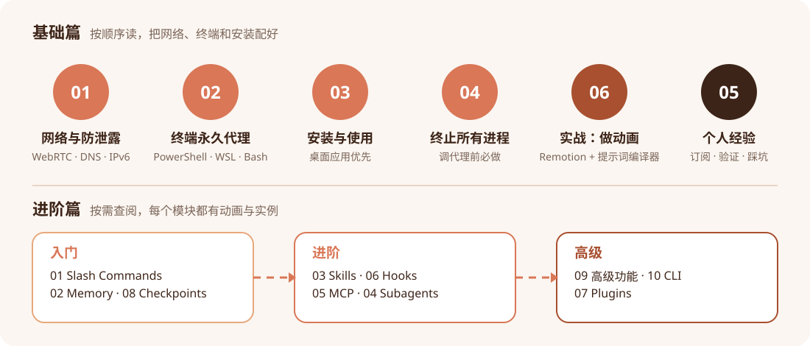

# 使用指南

## 阅读顺序

本书分为**基础篇**和**进阶篇**两部分。建议先按顺序读完基础篇，把网络、终端和安装配置好；进阶篇可以根据需要随时查阅。



### 基础篇

| 章节 | 内容 | 预计用时 |
| :-- | :-- | :--: |
| [01 · 网络准备与 IP 泄露检测](01-network.md) | 代理选择、WebRTC / DNS / IPv6 泄露检测、禁用 IPv6 | 10 分钟 |
| [02 · 终端永久代理配置](02-terminal-proxy.md) | PowerShell、CMD、WSL、Bash / Zsh 的永久代理 | 5 分钟 |
| [03 · 安装与使用](03-install-and-usage.md) | 安装（优先官方桌面应用）、登录、让 Claude 帮你配好代理与 TUN、快捷键、斜杠命令、`CLAUDE.md` | 20 分钟 |
| [04 · 终止所有 Claude 进程](04-stop-claude.md) | 调整代理前为什么必须先终止所有进程，以及一键终止脚本 | 3 分钟 |
| [06 · 实战：用 Claude + Remotion 做动画](06-remotion-animation.md) | 提示词编译器 + Remotion，从一句话到 MP4 | 30 分钟 |
| [05 · 个人经验](05-personal-notes.md) | 订阅、身份验证与踩坑记录 | 3 分钟 |

### 进阶篇

进阶篇以开源项目 claude-howto 的中文本土化版本为基础重新编写，每个模块都配有动画演示与实例。来源与许可见 [来源与许可](howto/index.md#来源与许可)。推荐的阅读方式：

1. 先看 [学习路线图](howto/LEARNING-ROADMAP.md)，用开头的自测清单判断自己处于哪个阶段；
2. 用 [概念总览](howto/claude_concepts_guide.md) 和 [功能总表](howto/CATALOG.md) 建立全局认识；
3. 按路线图进入对应模块深入学习；
4. 日常使用时查 [速查卡](howto/QUICK_REFERENCE.md)，并留意 [新能力速览](howto/WHATS-NEW.md)。

| 模块 | 内容 | 适合阶段 |
| :-- | :-- | :-- |
| [01 · Slash Commands](howto/01-slash-commands/README.md) | 内建命令与自定义命令 | 入门 |
| [02 · Memory](howto/02-memory/README.md) | `CLAUDE.md` 与自动记忆 | 入门 |
| [08 · Checkpoints](howto/08-checkpoints/README.md) | 检查点与回退，安全试错 | 入门 |
| [03 · Skills](howto/03-skills/README.md) | 可复用、可自动触发的技能 | 进阶 |
| [06 · Hooks](howto/06-hooks/README.md) | 事件驱动的自动化 | 进阶 |
| [05 · MCP](howto/05-mcp/README.md) | 接入 GitHub、数据库等外部工具 | 进阶 |
| [04 · Subagents](howto/04-subagents/README.md) | 子代理分工协作 | 进阶 |
| [09 · Advanced Features](howto/09-advanced-features/README.md) | Plan 模式、权限模式、后台任务等 | 高级 |
| [07 · Plugins](howto/07-plugins/README.md) | 打包分发给团队 | 高级 |
| [10 · CLI](howto/10-cli/README.md) | 命令行参数与脚本化 | 全阶段 |

### 互动自测

仓库中附带了两个来自原项目的学习 skill，可以在 Claude Code 中与 Claude 互动测验：

| 命令 | 作用 |
| :-- | :-- |
| `/self-assessment` | 评估你在 10 个能力域上的水平，生成个性化学习路径 |
| `/lesson-quiz <模块>` | 针对单个模块做 10 题测验，例如 `/lesson-quiz hooks` |

使用方法：

```bash
git clone https://github.com/PLANCK234/Claude-Guideline.git
cd Claude-Guideline
claude          # 在仓库根目录启动，skill 会被自动加载
```

然后输入 `/self-assessment` 或 `/lesson-quiz` 即可开始。

## 按操作系统阅读

涉及系统差异的地方，每章开头都有跳转表格。也可以从这里直接进入：

| 操作系统 | 禁用 IPv6 | 终端代理 | 安装 | 终止进程 |
| :-- | :-- | :-- | :-- | :-- |
| Windows | [跳转](01-network.md#windows) | [PowerShell](02-terminal-proxy.md#windows-终端) · [CMD](02-terminal-proxy.md#windows-终端) | [跳转](03-install-and-usage.md#方式一claude-桌面应用推荐) | [跳转](04-stop-claude.md#windows) |
| WSL | [跳转](01-network.md#linux--wsl) | [跳转](02-terminal-proxy.md#wsl) | [跳转](03-install-and-usage.md#macos--linux--wsl) | [跳转](04-stop-claude.md#wsl--linux--macos) |
| macOS | [跳转](01-network.md#macos) | [跳转](02-terminal-proxy.md#macos--linux) | [跳转](03-install-and-usage.md#方式一claude-桌面应用推荐) | [跳转](04-stop-claude.md#wsl--linux--macos) |
| Linux | [跳转](01-network.md#linux--wsl) | [跳转](02-terminal-proxy.md#macos--linux) | [跳转](03-install-and-usage.md#macos--linux--wsl) | [跳转](04-stop-claude.md#wsl--linux--macos) |

## 配套脚本

仓库中附带了几个脚本，可以在 [GitHub](https://github.com/PLANCK234/Claude-Guideline) 下载后使用：

| 脚本 | 作用 | 用法 |
| :-- | :-- | :-- |
| `stop-all-claude.bat` | 终止所有 Claude 进程（Windows） | 双击运行 |
| `scripts/proxy.ps1` | Windows 永久代理开关 | `.\scripts\proxy.ps1 on 7897` / `off` |
| `scripts/proxy.sh` | Bash / Zsh / WSL 永久代理开关 | `bash scripts/proxy.sh on 7897` / `off` |
| `scripts/ipv6.ps1` | 禁用 / 恢复 IPv6 | `.\scripts\ipv6.ps1 off` / `on` |
| `scripts/check.ps1` | 网络自检 | `.\scripts\check.ps1` |
| `scripts/stop-all-claude.sh` | 终止所有 Claude 进程（Linux / macOS / WSL） | `bash scripts/stop-all-claude.sh` |

> [!TIP]
> 如果 PowerShell 提示“禁止运行脚本”，先执行 `Set-ExecutionPolicy -Scope CurrentUser RemoteSigned`。

## 评论与提问

每一页底部都有同一个**留言板**：全站共用一个讨论帖，无论在哪一页留言，大家都能看到。遇到问题、有经验想分享、发现内容有误，都欢迎直接在留言板讨论，登录 GitHub 即可留言。

提问时，附上 `.\scripts\check.ps1` 或 `claude doctor` 的输出会更容易定位问题。请注意不要贴出完整公网 IP、代理订阅链接、API Key 或证件信息。

## 关于本书

本书是独立的社区教程，与 Anthropic 无关。Claude Code 更新频繁，书中的命令与界面可能随版本变化。进阶篇以开源项目为基础编写，原作版权归原作者所有，详见 [来源与许可](howto/index.md#来源与许可)。
