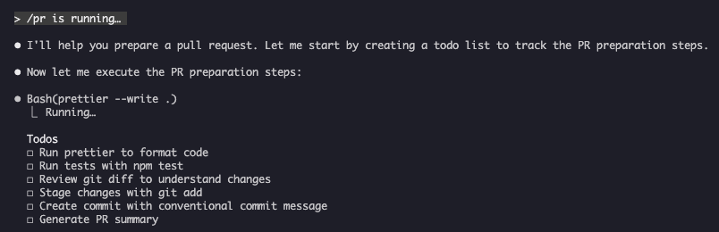

# 01 · Slash Commands：一个斜杠，召唤一个工作流

<div class="cd-lead" markdown>

**一句话：** 在输入框敲 `/`，就能调出一个命令。命令可以是 Claude Code 自带的，也可以是你自己写好的一套固定流程。写一次，以后每次只需输入一个斜杠。

</div>

<div class="cd-anim" markdown>


</div>

## 命令从哪里来

<div class="cd-cards" markdown>

<div markdown>

**内建命令**

`/help`、`/clear`、`/model` 等，开箱即用，无需安装。

</div>

<div markdown>

**自定义命令**

放在 `.claude/commands/` 或写成 skill，把你常用的一大段提示词变成 `/名字`。

</div>

<div markdown>

**插件命令**

安装 plugin 后自动出现，适合团队统一分发。

</div>

<div markdown>

**MCP 提示词**

MCP server 也可以暴露命令，接入外部系统时附带。

</div>

</div>

## 先记住这 12 个

| 命令 | 作用 | 什么时候用 |
| :-- | :-- | :-- |
| `/init` | 扫描项目，生成 `CLAUDE.md` | 新项目第一件事 |
| `/clear` | 清空当前对话 | 换话题时，省额度也更聪明 |
| `/compact [要求]` | 压缩对话，保留要点 | 对话很长但还要继续 |
| `/context` | 查看上下文占用 | 感觉 Claude “变笨”时先看这里 |
| `/model` | 切换模型 | 简单任务换快模型，难题换强模型 |
| `/effort` | 调整思考强度 | 复杂问题调高，琐碎任务调低 |
| `/plan` | 进入规划模式 | 多文件改动，先出方案再动手 |
| `/rewind` | 回退到之前的存档 | 改坏了，见 [08 · Checkpoints](../08-checkpoints/README.md) |
| `/resume` | 恢复以前的会话 | 继续昨天的工作 |
| `/code-review` | 审查当前改动的正确性问题 | 提交前自查 |
| `/doctor` | 诊断安装与配置 | 出现异常时 |
| `/usage` | 查看用量与限额 | 关心额度时 |

<details markdown>
<summary>更多实用内建命令</summary>

| 命令 | 作用 |
| :-- | :-- |
| `/config` | 查看或修改设置，修改会保存到 `~/.claude/settings.json` |
| `/memory` | 编辑记忆文件，见 [02 · Memory](../02-memory/README.md) |
| `/skills` · `/agents` · `/hooks` · `/mcp` · `/plugin` | 查看与管理对应能力 |
| `/cd <路径>` | 在当前会话中切换工作目录 |
| `/goal <目标>` | 为当前会话设定一个明确的完成目标 |
| `/recap` | 回到旧会话时，快速回顾刚才做了什么 |
| `/fork` · `/branch` · `/subtask` | 复制对话做实验，或委派一个会回传结果的子任务 |
| `/ultraplan` | 生成更完整的计划，在浏览器中审阅 |
| `/fewer-permission-prompts` | 分析常用命令，帮你生成合理的免确认列表 |
| `/team-onboarding` | 根据项目现有配置，生成新同事上手说明 |
| `/statusline` | 自定义终端底部状态栏 |

内建命令会随版本增减，以你当前版本 `/help` 的输出为准。

</details>

## 三步写出你的第一个命令

<div class="cd-steps" markdown>

1. **建目录**

    ```bash
    mkdir -p .claude/commands
    ```

2. **写一个 Markdown 文件**，文件名就是命令名。例如 `.claude/commands/pr.md`：

    ```markdown
    ---
    description: 整理代码、暂存改动并准备 pull request
    allowed-tools: Bash(git add:*), Bash(git status:*), Bash(git diff:*), Bash(npm test:*)
    ---

    在创建 PR 之前，请按下面步骤执行：

    1. 跑测试：`npm test`
    2. 检查 diff：`git diff HEAD`
    3. 暂存改动：`git add .`
    4. 生成符合 conventional commits 的提交信息
    5. 输出 PR 摘要：改了什么、为什么改、做了哪些测试
    ```

    `description` 会显示在命令菜单里；`allowed-tools` 让这些 git 命令免于逐条确认。

3. **在 Claude Code 中输入 `/pr`**，它就会按你写的清单一步步执行：

    

</div>

> [!TIP]
> 这个目录里已经备好了 8 个可直接使用的命令，复制到项目里即可：
> `cp docs/howto/01-slash-commands/*.md .claude/commands/`
> （注意不要把 `README.md` 也复制进去）

| 文件 | 命令 | 用途 |
| :-- | :-- | :-- |
| [`optimize.md`](optimize.md) | `/optimize` | 分析性能瓶颈与优化机会 |
| [`pr.md`](pr.md) | `/pr` | 提交 PR 前的整理与检查 |
| [`commit.md`](commit.md) | `/commit` | 生成规范的提交说明 |
| [`push-all.md`](push-all.md) | `/push-all` | 暂存、提交、推送一步完成 |
| [`unit-test-expand.md`](unit-test-expand.md) | `/unit-test-expand` | 扩充测试覆盖 |
| [`generate-api-docs.md`](generate-api-docs.md) | `/generate-api-docs` | 生成 API 文档 |
| [`doc-refactor.md`](doc-refactor.md) | `/doc-refactor` | 重组项目文档 |
| [`setup-ci-cd.md`](setup-ci-cd.md) | `/setup-ci-cd` | 初始化 CI/CD |

## 让命令更聪明：三个动态写法

=== "接收参数"

    ```markdown
    为 $ARGUMENTS 编写单元测试，覆盖正常路径和边界情况。
    ```

    调用：`/unit-test src/utils/date.ts`，`$ARGUMENTS` 会被替换为后面的内容；也可以用 `$0`、`$1` 取单个参数。

=== "引用文件"

    ```markdown
    按照 @docs/api-style.md 的规范，为新增接口补充文档。
    ```

    `@路径` 会把文件内容带入上下文，不必把整份规范复制进命令。

=== "先跑命令"

    ```markdown
    当前分支的改动如下：
    !`git diff --stat`

    请据此写一份变更说明。
    ```

    ``!`命令` `` 会先执行 shell 命令，再把输出拼进提示词。

## 命令还是 Skill？

| 你想要的 | 选择 |
| :-- | :-- |
| 自己明确触发，一个简短的固定动作 | **Slash Command** |
| 希望 Claude 自动判断何时使用 | **Skill** |
| 需要附带脚本、模板、参考资料 | **Skill** |
| 在多个项目中重复使用 | **Skill**（放在 `~/.claude/skills/`） |

两者现在是同一套机制：skill 同样可以用 `/名字` 手动调用。新写的复杂流程，推荐直接做成 [Skill](../03-skills/README.md)。

## 常见坑

| 现象 | 原因与解决 |
| :-- | :-- |
| 文件放好了，命令却没出现 | 检查路径是否为 `.claude/commands/`、扩展名是否为 `.md`、frontmatter 的 `---` 是否成对 |
| 命令能出现，但执行到 git 时反复确认 | 在 `allowed-tools` 中加上对应的 `Bash(...)` 规则 |
| 网上教程里的 `/vim`、`/pr-comments` 用不了 | 这些已被移除，以当前版本 `/help` 为准 |
| 命令名写成了中文 | 命令名、`description`、`allowed-tools` 等字段保持英文，只有正文可以写中文 |

## 下一步

<div class="cd-cards" markdown>

<div markdown>

**[02 · Memory →](../02-memory/README.md)**

让 Claude 每次都记住项目规则，不用重复交代。

</div>

<div markdown>

**[03 · Skills →](../03-skills/README.md)**

把复杂流程做成会自动触发的能力。

</div>

<div markdown>

**[速查卡 →](../QUICK_REFERENCE.md)**

常用命令与配置一页查完。

</div>

</div>
