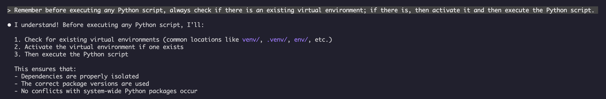

# 02 · Memory：让 Claude 记住你的规矩

<div class="cd-lead" markdown>

**一句话：** 把项目规则写进 `CLAUDE.md`，Claude 每次进入项目都会自动读取，不用你每次重新交代“用 pnpm”“先跑测试”“别动 legacy 目录”。

</div>

<div class="cd-anim" markdown>


</div>

## 什么时候该配

- 你发现自己**第三次**向 Claude 解释同一条规则；
- 团队有固定约定：命名规范、测试要求、Git 流程；
- 项目目录复杂，希望 Claude 一进来就知道哪个目录是干什么的。

## 四层记忆，各管一摊

| 层级 | 文件位置 | 放什么 | 是否提交 Git |
| :-- | :-- | :-- | :-- |
| 组织策略 | 由管理员统一下发 | 公司级安全与合规要求 | — |
| 个人偏好 | `~/.claude/CLAUDE.md` | 你在所有项目中的习惯，如“回复用中文” | 否 |
| **项目规则** | `./CLAUDE.md` 或 `./.claude/CLAUDE.md` | 技术栈、目录说明、测试与提交规范 | **是**，团队共享 |
| 本地私有 | `./CLAUDE.local.md` | 只对你自己生效的项目偏好 | 否，记得加进 `.gitignore` |

> [!IMPORTANT]
> 这几层是**拼接**在一起的，不是后面覆盖前面。子目录里的 `CLAUDE.md` 会在 Claude 读取该目录时额外补充，适合 monorepo 中给不同子项目写不同规则。

## 四种写入方式

=== "让 Claude 初始化"

    ```text
    /init
    ```

    Claude 会扫描项目，自动生成一份 `CLAUDE.md` 草稿，你再修改即可。新项目最推荐。

=== "直接说“记住”"

    ```text
    记住：执行任何 Python 脚本前，先检查并激活项目里的虚拟环境。
    ```

    Claude 会把它写进合适的记忆文件：

    

=== "手动编辑"

    ```text
    /memory
    ```

    打开记忆文件直接编辑，最可控。

=== "复制模板"

    ```bash
    cp docs/howto/02-memory/project-CLAUDE.md ./CLAUDE.md
    ```

    本目录提供了 [项目模板](project-CLAUDE.md)、[个人模板](personal-CLAUDE.md) 和 [子目录模板](directory-api-CLAUDE.md)。

## 一份好的 CLAUDE.md 长什么样

```markdown
# 项目记忆

## 项目概览
- TypeScript + Next.js 的 Web 应用，包管理使用 pnpm。

## 必须遵守
- 提交前运行 `pnpm test`，全部通过才能提交。
- 优先使用 async/await，不写 promise 链。
- API 变更必须同步更新 `docs/api.md`。

## 重要路径
- `src/app/` 页面与路由
- `src/server/` 服务端逻辑
- `legacy/` 旧代码，除非明确要求，否则不要修改

## 更多背景
- 架构说明见 @docs/architecture.md
```

**写什么最有价值：** 最容易被忽略的规则、提交前必须做的事、默认使用的工具、不能碰的文件、验收的最低标准。

**不该写什么：** 泛泛的项目介绍、经常变化的数据、多步骤的操作流程（这类应该做成 [Skill](../03-skills/README.md)）。

> [!TIP]
> 单个 `CLAUDE.md` 建议控制在 **200 行以内**。文件越长，Claude 对每条规则的遵循度越低。

## 用 `@` 引用其他文档

```markdown
项目概览见 @README.md
接口规范见 @docs/api-style.md
```

- 相对路径以**写这行的文件**为基准；
- 可以层层引用，最多 4 层；
- 引用只是拆分文件，内容仍会全部加载。真正想“按需加载”，用 [Skill](../03-skills/README.md)。

> [!NOTE]
> Claude Code 不会自动读取 `AGENTS.md`。如果项目里已有它，在 `CLAUDE.md` 中写一行 `@AGENTS.md` 即可复用。

## Auto Memory：Claude 自己的笔记本

除了你写的 `CLAUDE.md`，Claude 还会在长期使用中自己记笔记，保存在 `~/.claude/projects/<项目>/memory/`。

| | CLAUDE.md | Auto Memory |
| :-- | :-- | :-- |
| 谁来写 | 你 | Claude 自己 |
| 适合放 | 明确的规则 | 使用中沉淀下来的项目知识 |
| 启动时加载 | 全部 | 只加载索引的前 200 行（或前 25KB），其余按需读取 |

Auto Memory 默认开启，可以在 `/memory` 中关闭，或在 settings 中设置 `"autoMemoryEnabled": false`。两者搭配使用效果最好。

<details markdown>
<summary>进阶：设置文件的优先级</summary>

与记忆不同，`settings.json` 是**覆盖**关系，优先级从高到低：

1. 组织托管设置（managed settings）
2. 命令行参数
3. `.claude/settings.local.json`（本地，不提交）
4. `.claude/settings.json`（项目，提交）
5. `~/.claude/settings.json`（个人）

在 `/config` 中做的修改会写入第 5 层，并在之后的会话中继续生效。

</details>

<details markdown>
<summary>进阶：monorepo 中加载其他目录的记忆</summary>

```bash
export CLAUDE_CODE_ADDITIONAL_DIRECTORIES_CLAUDE_MD=1
claude --add-dir ../shared-lib
```

额外目录中的 `CLAUDE.md` 会和当前项目的记忆一起加载。

</details>

## 常见坑

| 现象 | 原因与解决 |
| :-- | :-- |
| 写了规则，Claude 时灵时不灵 | 文件太长或规则太泛。精简到最关键的几条，写得具体可执行 |
| 团队成员看到了我的个人偏好 | 个人偏好放 `~/.claude/CLAUDE.md` 或 `CLAUDE.local.md`，不要写进项目 `CLAUDE.md` |
| Claude 按旧规则办事 | 目录或规范变了，`CLAUDE.md` 没跟着改，记得同步更新 |
| 网上教程说用 `#` 开头快速记忆 | 旧写法已停用，改用 `/memory` 或直接说“记住……” |

## 下一步

<div class="cd-cards" markdown>

<div markdown>

**[03 · Skills →](../03-skills/README.md)**

把多步骤流程做成可复用的技能。

</div>

<div markdown>

**[08 · Checkpoints →](../08-checkpoints/README.md)**

放心让 Claude 改，改坏了随时回退。

</div>

<div markdown>

**[学习路线图 →](../LEARNING-ROADMAP.md)**

看看下一阶段该学什么。

</div>

</div>
