# 03 · Skills：把好用的流程变成 Claude 的本能

<div class="cd-lead" markdown>

**一句话：** Skill 是一个带说明书的文件夹。Claude 平时只记得它的名字和用途，等你的需求对上了，才去读完整说明、调用里面的脚本和模板。所以你可以装很多 skill，也不会占满上下文。

</div>

<div class="cd-anim" markdown>



</div>

## 它适合做什么

<div class="cd-cards" markdown>

<div markdown>

**代码审查**

固定的检查清单、评分标准、输出格式，每次审查都一致。

</div>

<div markdown>

**结构化重构**

先测试、再小步修改、每步可回退，按方法论执行。

</div>

<div markdown>

**文档生成**

按团队模板产出 README、API 文档、变更说明。

</div>

<div markdown>

**品牌语气**

营销文案、邮件、社媒帖子保持统一风格。

</div>

</div>

## 一个 skill 的结构

```text
refactor/
├── SKILL.md            ← 必需：名称、触发时机、执行步骤
├── scripts/            ← 可选：辅助脚本，例如检测代码坏味道
├── templates/          ← 可选：输出模板
└── references/         ← 可选：参考资料，需要时才读取
```

## 三步写出你的第一个 skill

<div class="cd-steps" markdown>

1. **选位置**

    | 放在 | 路径 | 生效范围 |
    | :-- | :-- | :-- |
    | 个人 | `~/.claude/skills/<名字>/SKILL.md` | 你的所有项目 |
    | 项目 | `.claude/skills/<名字>/SKILL.md` | 当前项目，可提交给团队 |

2. **写 `SKILL.md`**

    ```markdown
    ---
    name: commit-message
    description: 根据暂存区改动生成规范的中文提交信息。用户要求写提交信息、准备提交或输入 /commit-message 时使用。
    ---

    1. 运行 `git diff --cached` 查看已暂存的改动
    2. 判断类型：feat / fix / docs / refactor / test / chore
    3. 输出格式：`<类型>: <一句话说明>`，正文列出主要改动点
    4. 不要提交，只输出提交信息供用户确认
    ```

3. **使用**：直接说“帮我写个提交信息”，Claude 会自动匹配；也可以手动输入 `/commit-message`。

</div>

> [!IMPORTANT]
> `description` 决定 Claude 什么时候想起它。**把“什么时候用”写在最前面**，写得越具体越不容易误触发或漏触发。装的 skill 很多时，较长的描述会被截短，排在后面的内容可能被丢掉。

## 本目录的示例 skill

| skill | 用途 | 亮点 |
| :-- | :-- | :-- |
| [`code-review-specialist`](code-review-specialist/SKILL.md) | 代码审查 | 附带复杂度分析脚本与审查清单 |
| [`refactor`](refactor/SKILL.md) | 结构化重构 | 基于 Martin Fowler 方法论，含坏味道检测脚本 |
| [`doc-generator`](doc-generator/SKILL.md) | 文档生成 | 附带生成脚本 |
| [`brand-voice`](brand-voice/SKILL.md) | 文案语气统一 | 含邮件、社媒模板与语气示例 |
| [`blog-draft`](blog-draft/SKILL.md) | 博客草稿 | 大纲与正文模板 |
| [`claude-md`](claude-md/SKILL.md) | 生成或优化 `CLAUDE.md` | 配合 [02 · Memory](../02-memory/README.md) |

安装其中一个：

```bash
mkdir -p .claude/skills
cp -r docs/howto/03-skills/refactor .claude/skills/
```

## 自带的实用 skill

Claude Code 自带一批 skill，无需安装，用 `/名字` 调用：

| skill | 用途 |
| :-- | :-- |
| `/code-review` | 审查当前改动中的正确性问题 |
| `/simplify` | 清理重复代码、简化实现并直接修复 |
| `/run` · `/verify` | 启动项目、实际运行，确认改动真的生效，而不只是测试通过 |
| `/debug` | 读取调试日志，定位当前会话出错的原因 |
| `/batch` | 把同一类改动批量应用到很多文件 |
| `/loop` | 按固定间隔重复执行某个任务 |
| `/deep-research <主题>` | 深入研究某个主题 |

## 进阶：frontmatter 常用字段

<details markdown>
<summary>控制 skill 的触发与权限</summary>

| 字段 | 作用 | 示例 |
| :-- | :-- | :-- |
| `paths` | 只在匹配的文件路径下自动触发 | `paths: "src/api/**/*.ts"` |
| `allowed-tools` | skill 运行期间免确认的工具 | `Bash(npm test:*)` |
| `disallowed-tools` | skill 运行期间禁用的工具 | `Write` |
| `disable-model-invocation: true` | 只允许你手动调用，Claude 不会自动触发 | 部署类等高风险操作 |
| `user-invocable: false` | 不出现在 `/` 菜单，只供 Claude 自动使用 | 背景知识类 skill |
| `context: fork` | 在独立的分叉上下文中运行，不污染主对话 | 大型分析任务 |

正文中可以使用 `$ARGUMENTS`（调用参数）、`${CLAUDE_PROJECT_DIR}`（项目根目录）、``!`命令` ``（先执行再注入输出）等动态写法。

</details>

<details markdown>
<summary>团队环境中的安全开关</summary>

```json
{
  "disableSkillShellExecution": true,
  "skillOverrides": {
    "deploy": "user-invocable-only",
    "legacy-context": "off"
  }
}
```

- `disableSkillShellExecution`：禁止 skill 中的 ``!`命令` `` 自动执行；
- `skillOverrides`：不修改 skill 本身，控制它对 Claude 是否可见（`on` / `name-only` / `user-invocable-only` / `off`）。

同名 skill 的优先级为：企业 > 项目 > 个人。

</details>

## 常见坑

| 现象 | 原因与解决 |
| :-- | :-- |
| Claude 从不主动使用我的 skill | `description` 太泛，改写成“在什么场景下使用” |
| 不相关的时候也被触发 | 描述过于宽泛，或加上 `paths` 限定适用文件 |
| skill 写了一大段散文，执行效果差 | 改成编号步骤和明确的输出格式 |
| 新建的 skill 没出现 | 执行 `/reload-skills` 重新扫描，无需重启 |
| 本地 skill 和内建命令同名 | 会遮蔽内建命令，例如不要把自己的审查 skill 命名为 `code-review` |

## 下一步

<div class="cd-cards" markdown>

<div markdown>

**[04 · Subagents →](../04-subagents/README.md)**

把子任务交给专门的助手并行处理。

</div>

<div markdown>

**[06 · Hooks →](../06-hooks/README.md)**

在固定时机自动执行检查和格式化。

</div>

<div markdown>

**[06 章实战 →](../../06-remotion-animation.md)**

用一个“提示词编译器” skill 做动画。

</div>

</div>
