# 04 · Subagents：给 Claude 配一支专业小队

<div class="cd-lead" markdown>

**一句话：** Subagent 是主 Claude 手下的专职助手。每个子代理有自己的角色、自己的上下文和受限的工具权限。主 Claude 把子任务派出去，子代理做完只带回结论，主对话不会被细节塞满。

</div>

<div class="cd-anim" markdown>



</div>

## 为什么要用

<div class="cd-cards" markdown>

<div markdown>

**上下文隔离**

翻了 50 个文件的分析过程留在子代理里，主对话只收到一页结论。

</div>

<div markdown>

**专业分工**

审查、测试、安全、文档各有专门的系统提示词，做得更专业。

</div>

<div markdown>

**权限隔离**

审查员只给读权限，测试工程师才能运行命令，降低误操作风险。

</div>

<div markdown>

**并行推进**

多个方向同时分析，默认在后台运行，你可以继续和主 Claude 对话。

</div>

</div>

| 适合 | 不适合 |
| :-- | :-- |
| 大型代码审查、安全审查 | 单文件的小改动 |
| 调试与根因定位 | 简单的解释性问题 |
| 测试策略分析、文档生成 | 子任务之间需要频繁来回沟通 |
| 多个方向并行调研 | 你自己还没想清楚主任务 |

## 三步创建一个子代理

<div class="cd-steps" markdown>

1. **最简单的方式：直接让 Claude 帮你建**

    ```text
    创建一个负责安全审查的 subagent，只允许读取文件和搜索代码。
    ```

    Claude 会在 `.claude/agents/` 下生成对应的定义文件。

2. **或者手写一个文件**，例如 `.claude/agents/code-reviewer.md`：

    ```markdown
    ---
    name: code-reviewer
    description: 资深代码审查专家。代码修改完成后，主动用于质量、安全和可维护性检查。
    tools: Read, Grep, Glob, Bash
    model: inherit
    ---

    你是一名资深代码审查员。

    1. 运行 `git diff` 查看最近的改动
    2. 只关注被修改的文件
    3. 按“严重 / 建议 / 可选”三级列出问题，并给出修改示例
    ```

3. **使用**：说“让 code-reviewer 审查一下刚才的改动”，或者等 Claude 根据 `description` 自动委派。

</div>

## 本目录的 9 个现成角色

| 角色 | 文件 | 擅长 |
| :-- | :-- | :-- |
| 代码审查员 | [`code-reviewer.md`](code-reviewer.md) | 质量、安全、可维护性 |
| Clean Code 审查员 | [`clean-code-reviewer.md`](clean-code-reviewer.md) | 命名、函数长度、结构 |
| 测试工程师 | [`test-engineer.md`](test-engineer.md) | 测试覆盖与测试策略 |
| 安全审查员 | [`secure-reviewer.md`](secure-reviewer.md) | 漏洞与敏感信息 |
| 调试专家 | [`debugger.md`](debugger.md) | 报错分析与根因定位 |
| 性能优化师 | [`performance-optimizer.md`](performance-optimizer.md) | 先测基线，再找热点，一次改一处 |
| 文档工程师 | [`documentation-writer.md`](documentation-writer.md) | API 文档与使用说明 |
| 功能实现者 | [`implementation-agent.md`](implementation-agent.md) | 按需求完成编码 |
| 数据分析师 | [`data-scientist.md`](data-scientist.md) | SQL 与数据分析 |

```bash
mkdir -p .claude/agents
cp docs/howto/04-subagents/code-reviewer.md .claude/agents/
```

## 常用 frontmatter 字段

| 字段 | 作用 | 示例 |
| :-- | :-- | :-- |
| `name` | 唯一名称，不能包含 `:` | `code-reviewer` |
| `description` | 什么时候该委派给它 | 写清触发场景 |
| `tools` | 可用工具，留空则继承全部 | `Read, Grep, Glob` |
| `model` | 使用的模型 | `inherit` / `haiku`（省成本） |
| `permissionMode` | 子代理的权限模式 | `plan` |
| `skills` | 预加载的 skill | `refactor` |
| `color` | 在界面中的显示颜色 | `blue` |

<details markdown>
<summary>进阶：放在哪里、谁优先</summary>

| 位置 | 生效范围 |
| :-- | :-- |
| `.claude/agents/` | 当前项目 |
| `~/.claude/agents/` | 你的所有项目 |
| plugin 的 `agents/` | 随 plugin 启用 |

同名时的优先级：命令行 `--agents` 临时定义 > 项目级 > 个人级。monorepo 中有多个嵌套的 `.claude/agents/` 时，离当前工作目录最近的优先。

</details>

<details markdown>
<summary>进阶：嵌套、数量限制与 Agent Teams</summary>

- 子代理可以继续派出子代理，默认最多 3 层，设置 `CLAUDE_CODE_MAX_SUBAGENT_SPAWN_DEPTH=1` 可禁用嵌套；
- 同时运行的子代理默认最多 20 个，每个会话累计最多 200 个，防止委派失控；
- 子代理同样能发现项目和个人的 skill；
- **Agent Teams**（实验功能）与子代理不同：它是多个 Claude 实例互相协作、直接通信，适合大型并行工程。刚接触时掌握子代理就够了。

</details>

## 常见坑

| 现象 | 原因与解决 |
| :-- | :-- |
| Claude 从不委派给我的子代理 | `description` 太模糊，写清“在什么情况下使用” |
| 子代理什么都做不了 | `tools` 给得太少，补上必要的工具 |
| 子代理改了不该改的文件 | 工具给太多，审查类角色只给 `Read, Grep, Glob` |
| 任务很小也用子代理，反而更慢 | 小任务直接让主 Claude 做 |

## 下一步

<div class="cd-cards" markdown>

<div markdown>

**[05 · MCP →](../05-mcp/README.md)**

让 Claude 连接 GitHub、数据库等外部系统。

</div>

<div markdown>

**[06 · Hooks →](../06-hooks/README.md)**

用事件自动触发检查。

</div>

<div markdown>

**[07 · Plugins →](../07-plugins/README.md)**

把子代理打包分发给团队。

</div>

</div>
