# 05 · MCP：把 Claude 接到外部世界

<div class="cd-lead" markdown>

**一句话：** MCP（Model Context Protocol）是一个标准接口。装上对应的 MCP server，Claude 就能直接查 GitHub 的 PR、读数据库、操作浏览器、看 Notion 文档，而不只是基于你粘贴进来的内容回答。

</div>

<div class="cd-anim" markdown>



</div>

## 和 Memory 怎么区分

| | Memory | MCP |
| :-- | :-- | :-- |
| 提供什么 | 长期稳定的规则 | 实时、外部、动态的数据 |
| 例子 | “提交前跑测试” | “这个 PR 现在有哪些评论” |
| 怎么配置 | 写 `CLAUDE.md` | 添加 MCP server |

## 三步接入一个 MCP server

<div class="cd-steps" markdown>

1. **添加 server**，按对方提供的方式二选一：

    === "远程服务（HTTP）"

        ```bash
        claude mcp add --transport http notion https://mcp.notion.com/mcp
        ```

    === "本地程序（stdio）"

        ```bash
        claude mcp add --transport stdio github -- npx -y @modelcontextprotocol/server-github
        ```

2. **登录授权**（需要 OAuth 的服务）

    ```bash
    claude mcp login notion
    ```

    也可以在会话中输入 `/mcp`，选择对应 server 完成授权。

3. **直接用自然语言提需求**

    ```text
    帮我看看 PR #128 里有哪些未解决的评论，按文件整理出来。
    ```

</div>

## 选择保存范围

添加时用 `--scope`（简写 `-s`）决定配置写在哪里：

| 范围 | 写法 | 保存位置 | 适合 |
| :-- | :-- | :-- | :-- |
| 本地（默认） | `-s local` | `~/.claude.json` 中当前项目的条目 | 只有你在这个项目用 |
| 项目 | `-s project` | 仓库根目录的 `.mcp.json` | 提交到 Git，团队共享 |
| 用户 | `-s user` | `~/.claude.json` | 你的所有项目都能用 |

## 实例：用配置文件接入 GitHub

把下面的内容保存为项目根目录的 `.mcp.json`（即本目录的 [`github-mcp.json`](github-mcp.json)）：

```json
{
  "mcpServers": {
    "github": {
      "type": "stdio",
      "command": "npx",
      "args": ["@modelcontextprotocol/server-github"],
      "env": {
        "GITHUB_TOKEN": "${GITHUB_TOKEN}"
      }
    }
  }
}
```

token 不写进文件，而是从环境变量读取：

=== "PowerShell"

    ```powershell
    [Environment]::SetEnvironmentVariable('GITHUB_TOKEN', '你的 token', 'User')
    ```

=== "Bash / Zsh"

    ```bash
    echo 'export GITHUB_TOKEN="你的 token"' >> ~/.bashrc && source ~/.bashrc
    ```

本目录另有 [数据库](database-mcp.json)、[文件系统](filesystem-mcp.json) 和 [多 server 组合](multi-mcp.json) 示例。

> [!WARNING]
> 不要把 token、数据库密码直接写进 `.mcp.json` 再提交到仓库，一律用 `${环境变量}` 引用。

## 常用管理命令

| 命令 | 作用 |
| :-- | :-- |
| `/mcp` | 会话中查看所有 server 的连接状态、工具数量，并完成授权 |
| `claude mcp list` | 列出已配置的 server 及连接失败原因 |
| `claude mcp add ...` · `claude mcp remove <名字>` | 添加 / 删除 |
| `claude mcp login <名字>` · `logout` | 登录 / 登出；无浏览器环境加 `--no-browser` |
| `@server名:协议://路径` | 在对话中引用 MCP server 暴露的资源 |

<details markdown>
<summary>进阶：常驻加载、超时与后台运行</summary>

- **`alwaysLoad: true`**：让某个 server 的工具每轮都直接加载，不用等按需搜索。只给极高频的工具用，装多了会挤占上下文；
- **自动转后台**：单次 MCP 调用超过 2 分钟会自动转入后台，可用 `CLAUDE_CODE_MCP_AUTO_BACKGROUND_MS` 调整阈值；
- **MCP Apps**：MCP server 不只能返回文本，还能在对话中返回可交互的界面，如表单和图表；
- **项目信任**：仓库里的 `.mcp.json` 需要你先信任该项目才会启动，这是为了防止陌生仓库自动运行程序。

</details>

## 常见坑

| 现象 | 原因与解决 |
| :-- | :-- |
| `npx` 很慢、超时、安装失败 | 终端没走代理，见 [02 章](../../02-terminal-proxy.md) |
| GitHub server 连上了但没权限 | `GITHUB_TOKEN` 未设置、scope 不够，或只在某个终端窗口里临时设置了 |
| `/mcp` 显示 `0 tools` | server 启动失败或未授权，看 `claude mcp list` 中的错误信息 |
| 原生 Windows 上 `npx` 类 server 启动失败 | 把 `command` 改为 `cmd`，`args` 前加 `"/c", "npx"` |
| 修改了 `.mcp.json` 不生效 | 重启会话；项目级配置还需要重新批准 |

## 下一步

<div class="cd-cards" markdown>

<div markdown>

**[06 · Hooks →](../06-hooks/README.md)**

在工具调用前后自动执行检查。

</div>

<div markdown>

**[07 · Plugins →](../07-plugins/README.md)**

把 MCP 配置和其他能力一起打包。

</div>

<div markdown>

**[功能总表 →](../CATALOG.md)**

查看全部能力的全局地图。

</div>

</div>
