# 06 · Hooks：在固定时机自动执行你的脚本

<div class="cd-lead" markdown>

**一句话：** Hook 是一条“当……时，就……”的规则。例如“Claude 执行命令前，先检查是不是危险命令”“Claude 写完文件后，自动格式化”。它把你每次都要手动做的检查，变成自动执行的流程。

</div>

<div class="cd-anim" markdown>



</div>

## 最常用的 6 个触发时机

| 事件 | 什么时候触发 | 典型用途 |
| :-- | :-- | :-- |
| `SessionStart` | 会话开始或恢复时 | 注入当天的上下文、检查环境 |
| `UserPromptSubmit` | 你提交提示词时 | 检查提示词中是否含有敏感信息 |
| `PreToolUse` | Claude 调用工具**之前** | **拦截危险命令**、校验参数 |
| `PostToolUse` | 工具调用**之后** | **自动格式化**、运行 lint、记录日志 |
| `Stop` | Claude 准备结束回答时 | 检查测试是否已运行、任务是否完成 |
| `Notification` | Claude 需要你操作时 | 发送桌面或手机通知 |

完整事件超过 30 个，入门掌握这 6 个就足够了。

## 一条 hook 规则长什么样

写在 `settings.json` 里（个人 `~/.claude/settings.json`，或项目 `.claude/settings.json`）：

```js
{
  "hooks": {
    "PostToolUse": [                       // (1)!
      {
        "matcher": "Edit|Write",           // (2)!
        "hooks": [
          {
            "type": "command",             // (3)!
            "command": "npx prettier --write \"$(jq -r '.tool_input.file_path')\"",
            "timeout": 30
          }
        ]
      }
    ]
  }
}
```

1. **何时**：工具调用之后。
2. **对谁**：只匹配编辑和写入文件这两种工具，`*` 表示全部。
3. **做什么**：执行一条 shell 命令。hook 通过标准输入收到一段 JSON，这里用 `jq` 取出被修改的文件路径。

## 实例：拦截危险命令

<div class="cd-steps" markdown>

1. **复制示例脚本**

    ```bash
    mkdir -p ~/.claude/hooks
    cp docs/howto/06-hooks/pre-tool-check.sh ~/.claude/hooks/
    chmod +x ~/.claude/hooks/pre-tool-check.sh
    ```

2. **在 `~/.claude/settings.json` 中注册**

    ```json
    {
      "hooks": {
        "PreToolUse": [
          {
            "matcher": "Bash",
            "hooks": [
              { "type": "command", "command": "~/.claude/hooks/pre-tool-check.sh" }
            ]
          }
        ]
      }
    }
    ```

3. **效果**：Claude 试图执行 `rm -rf /` 这类命令时，脚本以 `exit 2` 退出并说明原因，命令被阻止，Claude 会看到原因并换一种做法。

</div>

> [!IMPORTANT]
> **只有 `exit 2` 才会阻止操作**，阻止原因要输出到 `stderr`（`echo "原因" >&2`）。`exit 1` 等其他非零退出码只算普通错误，**不会**拦住命令。`PostToolUse` 发生在操作之后，`exit 2` 只能把信息反馈给 Claude，无法撤销已完成的操作。

## 本目录的示例脚本

| 脚本 | 事件 | 作用 |
| :-- | :-- | :-- |
| [`pre-tool-check.sh`](pre-tool-check.sh) | `PreToolUse` | 拦截高风险 Bash 命令（推荐第一个试） |
| [`pre-commit.sh`](pre-commit.sh) | `PreToolUse` | 执行 `git commit` 前先跑测试 |
| [`format-code.sh`](format-code.sh) | `PostToolUse` | 写完文件自动格式化 |
| [`security-scan.sh`](security-scan.sh) | `PostToolUse` | 扫描密钥等敏感信息 |
| [`dependency-check.sh`](dependency-check.sh) | `PostToolUse` | 依赖清单变化后做漏洞扫描 |
| [`validate-prompt.sh`](validate-prompt.sh) | `UserPromptSubmit` | 校验提示词 |
| [`log-bash.sh`](log-bash.sh) | `PreToolUse` | 记录所有执行过的命令 |
| [`notify-team.sh`](notify-team.sh) | `Notification` | 通知团队 |
| [`session-end.sh`](session-end.sh) | `SessionEnd` | 会话结束时记录 |
| [`context-tracker.py`](context-tracker.py) | — | 追踪上下文用量 |

## 五种 hook 类型

| 类型 | 做什么 | 适合 |
| :-- | :-- | :-- |
| `command` | 执行本地 shell 命令 | 绝大多数场景 |
| `http` | 把事件发送到一个网址 | 通知系统、审计平台 |
| `mcp_tool` | 调用某个 MCP 工具 | 校验逻辑已做成 MCP server |
| `prompt` | 让模型根据提示词判断 | “任务是否真的完成了” |
| `agent` | 派一个代理做多步验证 | 复杂的质量门禁 |

<details markdown>
<summary>进阶：按参数精确匹配（<code>if</code>）</summary>

`matcher` 只能按工具名匹配。想进一步限定“只在修改 `src/` 时触发”“只在读取 `.env` 时拦截”，在具体 hook 上加 `if`：

```json
{
  "matcher": "Edit|Write",
  "hooks": [
    { "type": "command", "if": "Edit(src/**)", "command": "./hooks/lint-src.sh" }
  ]
}
```

常用写法：`Edit(src/**)`、`Read(.env)`、`Bash(git push *)`。

</details>

<details markdown>
<summary>进阶：用 JSON 输出精细控制</summary>

除了退出码，hook 还可以在标准输出返回 JSON：

- `PreToolUse` 返回 `permissionDecision`：`allow` / `deny` / `ask` / `defer`，多个 hook 意见冲突时 `deny` 优先；
- `updatedInput`：修改工具的输入参数后再执行；
- `additionalContext`：给 Claude 补充一段上下文，例如在 `Stop` 时提醒“请先运行测试”；
- `updatedToolOutput`：在 Claude 看到工具输出前先处理，例如去掉颜色码、脱敏。

```json
{
  "hookSpecificOutput": {
    "hookEventName": "Stop",
    "additionalContext": "请先运行测试，再说明任务完成。"
  }
}
```

</details>

## 常见坑

| 现象 | 原因与解决 |
| :-- | :-- |
| hook 返回错误，但命令照样执行了 | 用了 `exit 1`，阻止操作必须用 `exit 2` |
| 阻止了命令，但 Claude 说“没有原因” | 原因没有输出到 `stderr`，加上 `>&2` |
| 脚本没被执行 | 没有执行权限（`chmod +x`），或路径写错 |
| 脚本读不到文件路径 | 新版通过标准输入传 JSON，用 `jq -r '.tool_input.file_path'` 取值，而不是读第一个命令行参数 |
| Windows 上脚本跑不起来 | 确认 Git Bash 可用，或改用 PowerShell 脚本 |

## 下一步

<div class="cd-cards" markdown>

<div markdown>

**[07 · Plugins →](../07-plugins/README.md)**

把 hooks、skills、子代理打包成一套。

</div>

<div markdown>

**[09 · 高级功能 →](../09-advanced-features/README.md)**

权限模式与自动化的边界。

</div>

<div markdown>

**[速查卡 →](../QUICK_REFERENCE.md)**

hook 配置速查。

</div>

</div>
