# 09 · 高级功能：从“能用”到“好用”

<div class="cd-lead" markdown>

**一句话：** 高级功能的核心是两件事：**先想清楚再动手**（规划模式），以及**明确 Claude 能自己做多少事**（权限模式）。后台任务、无头模式、worktree、沙箱都建立在这两件事之上。

</div>

<div class="cd-anim" markdown>



</div>

## 最值得先掌握的四项

<div class="cd-cards" markdown>

<div markdown>

**[规划模式](#规划模式)**

复杂任务先出方案，你确认后再执行。

</div>

<div markdown>

**[权限模式](#权限模式)**

决定哪些操作需要你点头。

</div>

<div markdown>

**[后台任务](#后台任务与定时任务)**

耗时命令挂到后台，对话不被阻塞。

</div>

<div markdown>

**[无头模式](#无头模式)**

`claude -p` 接入脚本和 CI。

</div>

</div>

## 规划模式

先计划、后执行的两段式工作流。规划阶段**禁止任何文件写入**，Claude 只能阅读和分析。

=== "按快捷键"

    按 <kbd>Shift</kbd> + <kbd>Tab</kbd> 切换到 plan 模式，再描述任务。

=== "用命令"

    ```text
    /plan 实现用户登录与权限系统
    ```

=== "启动时指定"

    ```bash
    claude --permission-mode plan
    ```

**一份好计划应该包含：** 分阶段步骤、会修改哪些文件、风险点、验证方式、需要你拍板的地方。只有几句空话的计划，要求它重写。

| 适合 | 不适合 |
| :-- | :-- |
| 多文件重构、新功能设计、数据迁移、高风险改动 | 小 bug、单文件修改、简单提问 |

> [!TIP]
> 更复杂的任务可以用 `/ultraplan`：在云端生成更完整的计划，在浏览器中逐段审阅，再决定在哪里执行。

## 权限模式

| 模式 | 行为 | 适合 |
| :-- | :-- | :-- |
| `manual`（默认） | 读文件不打扰，修改和执行命令前逐一询问 | 日常使用、陌生项目 |
| `acceptEdits` | 改文件不再询问，执行命令仍需确认 | 方向已定、连续修改 |
| `plan` | 只读分析，禁止写入 | 先规划 |
| `auto` | 自动执行，每一步经后台安全分类器检查 | 理解风险后的自动化 |
| `dontAsk` | 只执行预先批准的工具，其余自动拒绝 | 无人值守的脚本 |
| `bypassPermissions` | 跳过所有确认 | **只在可丢弃的沙箱中使用** |

> [!WARNING]
> `--dangerously-skip-permissions`（即 `bypassPermissions`）会让 Claude 不经询问修改 `.git/`、`.claude/`、shell 配置等关键文件。不要在日常项目或存有重要凭证的机器上使用。

**减少重复确认的正确做法**不是放开全部权限，而是把常用的安全命令加入白名单：

```json
{
  "permissions": {
    "allow": ["Bash(npm test:*)", "Bash(git status)", "Bash(git diff:*)"],
    "deny": ["Read(./.env)", "Bash(rm -rf:*)"]
  }
}
```

也可以直接运行 `/fewer-permission-prompts`，让 Claude 分析你的使用习惯，生成一份合理的白名单。

## 深度思考

| 方式 | 作用范围 |
| :-- | :-- |
| 在提示词里写 `ultrathink` | 只让这一轮回答想得更深 |
| `/effort` 调整为 `high` / `xhigh` / `max` | 整个会话的思考强度 |
| <kbd>Alt</kbd> + <kbd>T</kbd>（macOS 为 <kbd>Option</kbd> + <kbd>T</kbd>） | 开关深度思考 |

不是所有问题都需要深度思考，但架构选型、边界条件分析这类问题，别让 Claude 秒答。

## 后台任务与定时任务

- **后台任务**：开发服务器、长时间测试、构建等耗时命令挂到后台运行，Claude 可以继续做别的事；
- **Monitor 工具**：让 Claude 持续盯住后台命令的输出事件，而不是反复轮询；
- **定时任务**：`/loop` 按固定间隔重复执行；`/schedule` 创建云端定时任务。

## 无头模式

`claude -p` 执行一次就退出，是接入脚本、CI/CD 的入口：

```bash
claude -p "运行测试并总结失败原因"
cat error.log | claude -p "解释这个错误"
```

详见 [10 · CLI](../10-cli/README.md)。

## 会话管理

| 操作 | 作用 |
| :-- | :-- |
| `/rename` | 给当前会话命名，任务一多就离不开 |
| `/resume` · `claude -r "名字"` | 恢复历史会话 |
| `claude -c` | 继续最近一次会话 |
| `/branch` | 切换到当前对话的副本做实验，原对话保留 |
| `/fork` | 复制出一个独立的后台会话，各自推进 |
| `/subtask <任务>` | 派一个继承完整对话的子任务，完成后把结果带回来 |

<details markdown>
<summary>更多高级能力</summary>

| 能力 | 一句话说明 |
| :-- | :-- |
| **Worktree** | `claude -w` 在独立的 git worktree 中启动，多个方案并行互不干扰 |
| **沙箱** | 限制 Claude 可访问的文件系统和网络，适合敏感环境；`sandbox.credentials` 可阻止读取凭证文件 |
| **Auto Mode** | `claude --permission-mode auto` 启动；后台分类器会产生额外 token 消耗，组织管理员可禁用 |
| **Agent Teams** | 多个 Claude 实例协作并直接通信，实验功能，用 `CLAUDE_CODE_EXPERIMENTAL_AGENT_TEAMS=1` 开启 |
| **动态工作流** | 在提示词中写 `ultracode`，让 Claude 编排大量后台子代理，适合全仓扫描、大规模迁移；`/workflows` 查看记录 |
| **安全模式** | `claude --safe-mode` 禁用所有自定义配置，用于排查是哪个配置导致的问题 |
| **全屏界面** | `/tui` 切换无闪烁的全屏终端界面，适合 tmux |
| **状态栏** | `/statusline` 自定义底部状态栏，显示分支、用量等信息 |
| **远程控制** | 在手机或网页上继续操作本机的会话 |

</details>

## 常见坑

| 现象 | 原因与解决 |
| :-- | :-- |
| plan 模式下 Claude 改不了文件 | 这是设计如此，确认计划后切回其他模式再执行 |
| 嫌确认太多，直接开了跳过权限 | 改用白名单或 `acceptEdits`，风险可控得多 |
| 会话太多，找不到昨天那个 | 养成 `/rename` 命名的习惯 |
| 把所有高级功能都打开 | 先掌握规划和权限两项，其他按需再学 |

## 下一步

<div class="cd-cards" markdown>

<div markdown>

**[10 · CLI →](../10-cli/README.md)**

命令行参数、结构化输出与批处理。

</div>

<div markdown>

**[学习路线图 →](../LEARNING-ROADMAP.md)**

检查自己处在哪个阶段。

</div>

</div>
