# 10 · CLI：一条命令，接进任何流程

<div class="cd-lead" markdown>

**一句话：** 交互模式适合聊，`claude -p` 适合干活。给一条明确的任务，拿到一个结果就退出，于是 Claude 可以被写进 shell 脚本、CI/CD、定时任务，和其他命令用管道串在一起。

</div>

<div class="cd-anim" markdown>



</div>

## 先熟练这四个

| 命令 | 作用 |
| :-- | :-- |
| `claude` | 进入交互模式 |
| `claude -p "任务"` | 无头模式：执行一次就退出 |
| `claude -c` | 继续最近一次会话 |
| `claude -r "名字"` | 恢复指定会话 |

| 你要做的 | 用哪个 |
| :-- | :-- |
| 连续对话、边改边聊 | `claude` |
| 给一条明确任务，拿结果就走 | `claude -p` |

## 实用例子

=== "分析日志"

    ```bash
    cat error.log | claude -p "解释这个错误，并给出修复建议" > report.md
    ```

=== "只读审查"

    ```bash
    claude --permission-mode plan "审查这个代码库的架构问题"
    ```

=== "限制工具"

    ```bash
    claude -p --tools "Read,Grep,Glob" "找出所有 TODO 注释"
    ```

=== "结构化输出"

    ```bash
    claude -p --output-format json "列出 main.py 中的所有函数" | jq '.result'
    ```

=== "批量处理"

    ```bash
    for file in docs/*.md; do
      claude -p "用三句话总结这份文档：$(cat "$file")" > "${file%.md}.summary.txt"
    done
    ```

=== "控制成本"

    ```bash
    claude -p --max-budget-usd 5 "分析整个仓库的依赖风险"
    ```

## 常用参数

| 参数 | 作用 |
| :-- | :-- |
| `-p, --print` | 无头模式 |
| `-c, --continue` | 继续最近一次会话 |
| `-r, --resume` | 恢复指定会话 |
| `-n, --name` | 给会话命名 |
| `-w, --worktree` | 在独立的 git worktree 中启动 |
| `--model` | 指定模型 |
| `--effort` | 思考强度：`low` 到 `max` |
| `--permission-mode` | 权限模式，见 [09 · 高级功能](../09-advanced-features/README.md#权限模式) |
| `--allowedTools` · `--disallowedTools` · `--tools` | 允许 / 禁止 / 限定可用工具 |
| `--output-format` | `text` / `json` / `stream-json` |
| `--json-schema` | 按 JSON Schema 约束输出结构 |
| `--max-budget-usd` | 本次运行的费用上限 |
| `--add-dir` | 把额外目录加入工作范围 |
| `--safe-mode` | 禁用所有自定义配置，排查问题用 |

## 管理类子命令

| 命令 | 作用 |
| :-- | :-- |
| `claude mcp` | 管理 MCP server，见 [05 · MCP](../05-mcp/README.md) |
| `claude plugin` | 管理插件，见 [07 · Plugins](../07-plugins/README.md) |
| `claude agents` | 打开多会话管理界面；加 `--json` 输出列表供脚本使用 |
| `claude auth status` | 查看登录状态：已登录返回 `0`，未登录返回 `1`，适合 CI 中提前检查 |
| `claude doctor` | 诊断安装与配置 |
| `claude project purge --dry-run` | 预览清理某个项目的本地数据 |

## 写进 CI 之前的检查清单

<div class="cd-steps" markdown>

1. **先在本地手动跑通**同一条 `claude -p` 命令；
2. **限定工具和权限**：用 `--tools` 或 `--permission-mode dontAsk`，只给任务需要的能力；
3. **约束输出格式**：下游要解析的，用 `--output-format json` 或 `--json-schema`；
4. **设置预算上限**：`--max-budget-usd` 防止意外消耗；
5. **先检查登录**：在流水线开头执行 `claude auth status`。

</div>

> [!NOTE]
> 不存在通用的 `--batch` 参数，批量处理请用 shell 循环，每个文件单独调用一次。

## 常见坑

| 现象 | 原因与解决 |
| :-- | :-- |
| 用 `-p` 做多轮对话，体验很差 | `-p` 是一次性的，连续对话用交互模式 |
| 恢复会话时权限模式不对 | 恢复时重新带上 `--permission-mode` |
| 在 CI 中卡住不动 | 有操作在等确认，用 `dontAsk` 模式并预先批准需要的工具 |
| 命令在 PowerShell 中报错 | 引号和管道写法与 Bash 不同，按当前 shell 调整 |

## 下一步

<div class="cd-cards" markdown>

<div markdown>

**[速查卡 →](../QUICK_REFERENCE.md)**

所有常用命令一页查完。

</div>

<div markdown>

**[互动自测 →](../../guide.md#互动自测)**

用 `/self-assessment` 检验学习成果。

</div>

<div markdown>

**[返回总览 →](../index.md)**

查看全部模块。

</div>

</div>
